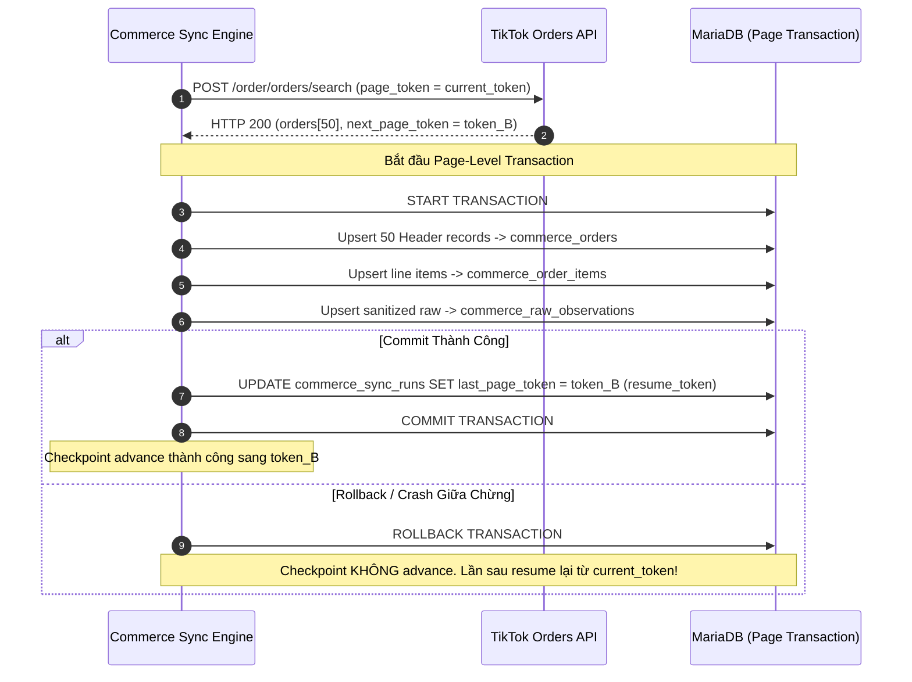

# HF1.2 PHASE 1A — CORE ORDERS ENGINE TECHNICAL IMPLEMENTATION PLAN (REVISION 1.1)

**Dự án:** ADDP Commerce Intelligence (`marketing.addp.vn`)  
**Tác giả:** Principal Solution Architect, Senior PHP Backend Engineer, Lead Data Engineer  
**Phiên bản:** 1.1.0 (Conditionally Approved & Hardened Specification)  
**Ngày cập nhật:** 29/09/2026  
**Chế độ thực thi:** STRICT PLANNING & HARDENED SPECIFICATION  
**Chỉ số an toàn bất biến:**  
`FILES CHANGED = 0` | `DB CHANGES = 0` | `PRODUCTION CHANGES = 0` | `API WRITE MUTATIONS = 0`

---

## MỤC LỤC

1. [Executive Summary](#1-executive-summary)
2. [Scope / Non-Scope Matrix](#2-scope--non-scope-matrix)
3. [Existing Code Impact Matrix](#3-existing-code-impact-matrix)
4. [Proposed Database Schema (DDL)](#4-proposed-database-schema-ddl)
5. [Field Mapping API → Database & Centralized Contract](#5-field-mapping-api--database--centralized-contract)
6. [PII Data Classification & Sanitization Policy](#6-pii-data-classification--sanitization-policy)
7. [Sync State Machine & Three-Token Checkpoint Model](#7-sync-state-machine--three-token-checkpoint-model)
8. [Backfill Algorithm (Initial Sync)](#8-backfill-algorithm-initial-sync)
9. [Incremental Algorithm (Delta Sync via update_time)](#9-incremental-algorithm-delta-sync-via-updatetime)
10. [Idempotency Strategy & Transaction Boundaries](#10-idempotency-strategy--transaction-boundaries)
11. [Raw Data / Provenance Strategy](#11-raw-data--provenance-strategy)
12. [Reconciliation Design against Benchmark (Snapshot ID=13)](#12-reconciliation-design-against-benchmark-snapshot-id13)
13. [Error / Retry / Rate Limit Strategy](#13-error--retry--rate-limit-strategy)
14. [Migration Plan](#14-migration-plan)
15. [File-by-File Change Plan](#15-file-by-file-change-plan)
16. [Test Matrix (25 Required Automated Scenarios)](#16-test-matrix-25-required-automated-scenarios)
17. [Release Gates (Gates A — F & Revised Gate E)](#17-release-gates-gates-a--f--revised-gate-e)
18. [Rollback Strategy](#18-rollback-strategy)
19. [Risk Register](#19-risk-register)
20. [Explicit Acceptance Criteria & Invariant Sign-Off](#20-explicit-acceptance-criteria--invariant-sign-off)

---

## 1. EXECUTIVE SUMMARY

Tài liệu này thiết lập kế hoạch triển khai kỹ thuật hoàn chỉnh cho **HF1.2 Core Orders Engine (Revision 1.1)** của hệ thống ADDP Commerce Intelligence. Mục tiêu trung tâm là đưa **TikTok Shop Orders API** trở thành **Nguồn dữ liệu chính (Primary Source)** phục vụ vận hành đơn hàng (*Order Operations*), bãi bỏ hoàn toàn sự phụ thuộc vào nạp thủ công file Excel/CSV trong quy trình vận hành thường nhật.

### Các điều chỉnh trọng yếu trong Revision 1.1 (Theo phê duyệt của Product Owner):
1. **Chuẩn hóa Gate E / Reconciliation:** Bãi bỏ hoàn toàn điều kiện cứng *"API phải khớp Compass $\ge 99\%$ mới PASS"*. Thay vào đó, Gate E tập trung vào: Tính trọn vẹn ingestion, tính toàn vẹn phân trang, 0 duplicate, tính bất biến idempotent, toàn vẹn trường và khả năng giải trình chênh lệch (*Discrepancy Explainability*). Compass Snapshot ID=13 chỉ là **Reference Source**, không phải mục tiêu ép bằng.
2. **Mô hình Checkpoint 3 Con Trỏ (Three-Token Checkpoint Model):** Phân định rạch ròi giữa `current_page_token`, `next_page_token`, và `resume_page_token`. Checkpoint chỉ được ghi nhận sau khi transaction cấp trang đã `COMMIT` thành công. Nếu rollback, checkpoint giữ nguyên.
3. **Quản trị API Contract tập trung:** Sử dụng endpoint chính thức `POST /order/202309/orders/search`, scope `seller.order.info`, cấu hình `page_size = 100` (ưu tiên tối ưu I/O), dùng `update_time_ge` làm hợp đồng gia tăng, và định nghĩa tập trung qua hằng số cấu hình.

---

## 2. SCOPE / NON-SCOPE MATRIX

Để đảm bảo tính tập trung cao độ và giảm thiểu rủi ro triển khai, phạm vi kỹ thuật của HF1.2 được phân định rạch ròi:

```
+---------------------------------------------------------------------------------------+
|                                    HF1.2 CORE SCOPE                                   |
| - TikTok Order Search Connector (POST /order/202309/orders/search)                    |
| - Cursor pagination với next_page_token, page_size = 100 & phát hiện con trỏ lặp      |
| - Incremental Delta Sync (update_time watermark + 2-hour safety overlap)              |
| - Chuẩn hóa Order Header (commerce_orders) & Line Items (commerce_order_items)        |
| - Quản lý phiên đồng bộ & checkpoint 3 con trỏ (commerce_sync_runs)                   |
| - Lưu trữ dữ liệu thô đã khử PII phục vụ kiểm toán (commerce_raw_observations)        |
| - Idempotent upsert & transaction boundaries an toàn cấp trang (Page-level)           |
| - Xử lý ngắt kết nối, timeout (5s/30s), HTTP 429, 5xx, và race condition refresh token|
| - Nền tảng đối soát (Reconciliation Foundation) so với Benchmark Snapshot ID=13       |
+---------------------------------------------------------------------------------------+
                                           |
                                           | [TÁCH RIÊNG CÁC PHÂN HỆ TIẾP THEO]
                                           v
+---------------------------------------------------------------------------------------+
|                                  EXPLICIT NON-SCOPE                                   |
| - Xử lý chi tiết và tính toán khấu trừ Return/Refund ---------------------> HF1.3     |
| - Tính toán tổn thất hủy đơn (Cancellation Loss) -------------------------> HF1.3     |
| - Vận hành vòng đời giao vận chi tiết (seller.logistics) ------------------> HF1.3     |
| - Bóc tách Bảng kê sao kê tài chính & Quyết toán dòng tiền (Statements) -> HF1.4     |
| - Bóc tách chi tiết phí sàn và hoa hồng Affiliate/KOC theo từng SKU -----> HF1.4     |
| - Shop Analytics API (Video Performance, Live Performance) ---------------> HF1.5     |
| - Tính toán các chỉ số phái sinh: Realized GMV, ROI hoàn hủy, Net Profit -> HF1.4/1.5 |
| - Bỏ nguồn Affiliate Orders XLSX của module Affiliate & ADS GMV ---------> CHƯA BỎ   |
+---------------------------------------------------------------------------------------+
```

> [!IMPORTANT]
> **Cam kết về nguồn dữ liệu Affiliate Orders XLSX:**  
> HF1.2 **tuyệt đối không được coi là lý do để loại bỏ** nguồn dữ liệu `Affiliate Orders XLSX` đang phục vụ cho module Affiliate & ADS GMV. Order Search API của TikTok chỉ trả về dữ liệu đơn hàng cơ bản, chưa chứng minh đủ các trường gán nguồn phân bổ (*Attribution*), mã nhà sáng tạo (*Creator ID/Username*), và tỷ lệ hoa hồng chi tiết. Nguồn XLSX tiếp tục được duy trì song song cho đến khi hoàn tất phân hệ HF1.4 và HF1.5.

---

## 3. EXISTING CODE IMPACT MATRIX

Rà soát toàn diện các điểm chạm trong mã nguồn hiện hành và phân loại tác động kỹ thuật:

| Tệp mã nguồn | Vị trí / Dòng thực tế | Hiện trạng mã nguồn cũ | Tác động trong HF1.2 | Phân loại hành động |
| :--- | :--- | :--- | :--- | :---: |
| [`public/api/sync.php`](file:///c:/AdsTiktok/public/api/sync.php) | L343–L346 | `if ($forceSync \|\| $orderCount == 0)`: Đóng băng không gọi API nếu bảng đã có $\ge 1$ đơn. | Giữ nguyên cho luồng legacy; không sửa trực tiếp để tránh hỏng dashboard cũ. | **B (Nên sửa sau khi V2 ổn định)** |
| [`public/api/sync.php`](file:///c:/AdsTiktok/public/api/sync.php) | L358–L360 | `$maxPages = 4`: Giới hạn cứng 200 đơn ($4 \times 50$). | Bộ đồng bộ mới `commerce_sync_service.php` chạy không giới hạn trang; legacy giữ nguyên. | **A (Giải quyết triệt để tại Core V2)** |
| [`public/api/sync.php`](file:///c:/AdsTiktok/public/api/sync.php) | L381–L398 | Tính `total_amount = sale_price * quantity`, không lưu bảng Order Items riêng. | Core V2 lưu tách biệt `commerce_orders` và `commerce_order_items`. | **A (Giải quyết triệt để tại Core V2)** |
| [`public/api/sync.php`](file:///c:/AdsTiktok/public/api/sync.php) | L511–L512 | `$totalShopGmv = max($totalRealGmv, $totalAdGmv)`: Thay thế số liệu bằng hàm `max()`. | Core V2 tuyệt đối không dùng `max()`. Báo cáo đối soát V2 tách riêng các nguồn. | **C (Không thay đổi legacy lúc này)** |
| [`public/api/tiktok_client.php`](file:///c:/AdsTiktok/public/api/tiktok_client.php) | L65–L66 | `TIMEOUT = 5s`, `CONNECTTIMEOUT = 3s`: Dễ bị ngắt kết nối giữa chừng khi mạng chậm. | Tách rời: `CONNECTTIMEOUT = 5s`, `TIMEOUT = 30s` cho các hàm tìm kiếm đơn. | **A (Bắt buộc nâng cấp trong HF1.2)** |
| [`public/api/tiktok_client.php`](file:///c:/AdsTiktok/public/api/tiktok_client.php) | L86–L101 | Không có cơ chế Bounded Retry và Exponential Backoff khi gặp HTTP 429 hoặc 5xx. | Bổ sung hàm thực thi request có kiểm soát retry (tối đa 3 lần) và giãn cách lũy thừa. | **A (Bắt buộc nâng cấp trong HF1.2)** |
| [`public/api/tiktok_client.php`](file:///c:/AdsTiktok/public/api/tiktok_client.php) | L287 | Gọi nhầm phương thức `POST /finance/202309/statements` (Lỗi HTTP 405). | Giữ nguyên trạng; không can thiệp trong HF1.2 vì Finance thuộc phạm vi HF1.4. | **C (Thuộc phạm vi HF1.4)** |
| [`public/api/db.php`](file:///c:/AdsTiktok/public/api/db.php) | L603–L653 | `getValidTikTokAccessToken()` refresh token không có khóa cơ sở dữ liệu. | Bổ sung giao dịch khóa dòng bi quan (`SELECT ... FOR UPDATE`) chống Race Condition. | **A (Bắt buộc nâng cấp trong HF1.2)** |
| [`public/api/db.php`](file:///c:/AdsTiktok/public/api/db.php) | L318–L327 | Schema `tiktok_orders`: Chỉ có 5 cột cơ bản. | Giữ nguyên 100% để bảo đảm tương thích ngược với các query cũ. | **Bảo lưu bất biến** |

---

## 4. PROPOSED DATABASE SCHEMA (DDL)

Thiết kế 4 bảng dữ liệu mới thuộc không gian tên chuẩn hóa `commerce_*`. Cấu trúc sẵn sàng cho mô hình đa nền tảng (*Multi-Platform: TikTok Shop, Shopee, Lazada*) và đa cửa hàng (*Multi-Shop*). Khóa chính nội bộ sử dụng `BIGINT UNSIGNED AUTO_INCREMENT`, tính đơn nhất nghiệp vụ dựa trên cặp khóa tự nhiên `(platform, shop_id, platform_order_id)`.

### 4.1. Bảng 1: `commerce_orders` (Order Header Chuẩn Hóa)
```sql
CREATE TABLE IF NOT EXISTS `commerce_orders` (
    `id` BIGINT UNSIGNED NOT NULL AUTO_INCREMENT,
    `platform` VARCHAR(32) NOT NULL DEFAULT 'tiktok_shop' COMMENT 'Nền tảng thương mại: tiktok_shop, shopee, etc.',
    `shop_id` VARCHAR(64) NOT NULL COMMENT 'Định danh cửa hàng trên nền tảng',
    `platform_order_id` VARCHAR(64) NOT NULL COMMENT 'Mã đơn hàng gốc do sàn cấp',
    `order_status` VARCHAR(50) NOT NULL COMMENT 'Trạng thái chuẩn hóa hệ thống: UNPAID, AWAITING_SHIPMENT, IN_TRANSIT, DELIVERED, COMPLETED, CANCELLED',
    `platform_status` VARCHAR(50) NOT NULL COMMENT 'Trạng thái nguyên bản trả về từ sàn',
    `platform_created_at` TIMESTAMP NULL DEFAULT NULL COMMENT 'Thời điểm đặt hàng (múi giờ gốc chuyển về UTC)',
    `platform_updated_at` TIMESTAMP NULL DEFAULT NULL COMMENT 'Thời điểm đơn thay đổi trạng thái gần nhất',
    `paid_at` TIMESTAMP NULL DEFAULT NULL COMMENT 'Thời điểm người mua thanh toán',
    `currency` VARCHAR(10) NOT NULL DEFAULT 'VND' COMMENT 'Đơn vị tiền tệ giao dịch',
    `order_gross_amount` DECIMAL(15,2) NOT NULL DEFAULT '0.00' COMMENT 'Tổng số tiền người mua phải thanh toán (payment.total_amount)',
    `sub_total` DECIMAL(15,2) NOT NULL DEFAULT '0.00' COMMENT 'Tổng giá trị hàng hóa trước chiết khấu',
    `shipping_fee` DECIMAL(15,2) NOT NULL DEFAULT '0.00' COMMENT 'Cước phí giao hàng',
    `seller_discount` DECIMAL(15,2) NOT NULL DEFAULT '0.00' COMMENT 'Chiết khấu do người bán tài trợ',
    `platform_discount` DECIMAL(15,2) NOT NULL DEFAULT '0.00' COMMENT 'Trợ giá voucher do sàn TikTok tài trợ',
    `tax_amount` DECIMAL(15,2) NOT NULL DEFAULT '0.00' COMMENT 'Thuế giá trị gia tăng (nếu bóc tách riêng)',
    `shipping_provider` VARCHAR(100) NULL DEFAULT NULL COMMENT 'Đơn vị vận chuyển (J&T, Ninja Van, SPX)',
    `tracking_number` VARCHAR(100) NULL DEFAULT NULL COMMENT 'Mã vận đơn bưu kiện',
    `delivery_type` VARCHAR(50) NULL DEFAULT NULL COMMENT 'Phương thức giao: TIKTOK_SHIPPING hoặc SELLER_SHIPPING',
    `is_split_order` TINYINT(1) NOT NULL DEFAULT 0 COMMENT 'Cờ đánh dấu đơn bị tách nhiều kiện hàng',
    `sync_run_id` BIGINT UNSIGNED NULL DEFAULT NULL COMMENT 'ID của phiên đồng bộ nạp bản ghi này',
    `raw_observation_id` BIGINT UNSIGNED NULL DEFAULT NULL COMMENT 'ID liên kết bản ghi quan sát thô gần nhất',
    `created_at` TIMESTAMP NOT NULL DEFAULT CURRENT_TIMESTAMP,
    `updated_at` TIMESTAMP NOT NULL DEFAULT CURRENT_TIMESTAMP ON UPDATE CURRENT_TIMESTAMP,
    PRIMARY KEY (`id`),
    UNIQUE KEY `uq_platform_shop_order` (`platform`, `shop_id`, `platform_order_id`),
    KEY `idx_shop_status` (`shop_id`, `order_status`),
    KEY `idx_platform_created` (`platform_created_at`),
    KEY `idx_platform_updated` (`platform_updated_at`),
    KEY `idx_sync_run` (`sync_run_id`)
) ENGINE=InnoDB DEFAULT CHARSET=utf8mb4 COLLATE=utf8mb4_unicode_ci;
```

### 4.2. Bảng 2: `commerce_order_items` (Order Line Items Chuẩn Hóa)
```sql
CREATE TABLE IF NOT EXISTS `commerce_order_items` (
    `id` BIGINT UNSIGNED NOT NULL AUTO_INCREMENT,
    `order_id` BIGINT UNSIGNED NOT NULL COMMENT 'Khóa ngoại trỏ về commerce_orders.id',
    `platform` VARCHAR(32) NOT NULL DEFAULT 'tiktok_shop',
    `shop_id` VARCHAR(64) NOT NULL,
    `platform_order_id` VARCHAR(64) NOT NULL COMMENT 'Mã đơn hàng gốc để tăng tốc truy vấn phẳng',
    `platform_line_item_id` VARCHAR(64) NOT NULL COMMENT 'Mã dòng sản phẩm gốc từ API (line_items[].id)',
    `product_id` VARCHAR(64) NOT NULL COMMENT 'Mã sản phẩm trên TikTok Shop',
    `product_name` VARCHAR(255) NOT NULL COMMENT 'Tên sản phẩm tại thời điểm mua',
    `sku_id` VARCHAR(64) NOT NULL COMMENT 'Mã SKU phân loại hàng',
    `sku_name` VARCHAR(255) NULL DEFAULT NULL COMMENT 'Tên quy cách phân loại (Combo 3 tuýp, etc.)',
    `sku_image` VARCHAR(512) NULL DEFAULT NULL COMMENT 'Đường dẫn ảnh đại diện của SKU',
    `quantity` INT NOT NULL DEFAULT 1 COMMENT 'Số lượng sản phẩm đặt mua',
    `sale_price` DECIMAL(15,2) NOT NULL DEFAULT '0.00' COMMENT 'Đơn giá bán thực tế cho 1 đơn vị',
    `original_price` DECIMAL(15,2) NOT NULL DEFAULT '0.00' COMMENT 'Đơn giá niêm yết trước giảm giá',
    `seller_discount` DECIMAL(15,2) NOT NULL DEFAULT '0.00' COMMENT 'Chiết khấu shop trên dòng hàng',
    `platform_discount` DECIMAL(15,2) NOT NULL DEFAULT '0.00' COMMENT 'Trợ giá sàn trên dòng hàng',
    `room_id` VARCHAR(64) NULL DEFAULT NULL COMMENT 'ID phòng Live nếu phát sinh từ Livestream',
    `line_item_status` VARCHAR(50) NULL DEFAULT NULL COMMENT 'Trạng thái riêng của dòng hàng (nếu có)',
    `created_at` TIMESTAMP NOT NULL DEFAULT CURRENT_TIMESTAMP,
    `updated_at` TIMESTAMP NOT NULL DEFAULT CURRENT_TIMESTAMP ON UPDATE CURRENT_TIMESTAMP,
    PRIMARY KEY (`id`),
    UNIQUE KEY `uq_platform_shop_item` (`platform`, `shop_id`, `platform_line_item_id`),
    KEY `idx_order_id` (`order_id`),
    KEY `idx_product_sku` (`product_id`, `sku_id`),
    KEY `idx_room_id` (`room_id`),
    CONSTRAINT `fk_order_items_parent` FOREIGN KEY (`order_id`) REFERENCES `commerce_orders` (`id`) ON DELETE CASCADE
) ENGINE=InnoDB DEFAULT CHARSET=utf8mb4 COLLATE=utf8mb4_unicode_ci;
```

### 4.3. Bảng 3: `commerce_sync_runs` (Quản Lý Phiên Đồng Bộ & Checkpoint 3 Con Trỏ)
```sql
CREATE TABLE IF NOT EXISTS `commerce_sync_runs` (
    `id` BIGINT UNSIGNED NOT NULL AUTO_INCREMENT,
    `platform` VARCHAR(32) NOT NULL DEFAULT 'tiktok_shop',
    `shop_id` VARCHAR(64) NOT NULL,
    `sync_type` ENUM('INITIAL_BACKFILL', 'INCREMENTAL_DELTA', 'MANUAL_RANGE') NOT NULL,
    `status` ENUM('PENDING', 'RUNNING', 'COMPLETED', 'FAILED', 'INTERRUPTED') NOT NULL DEFAULT 'PENDING',
    `window_start_time` TIMESTAMP NULL DEFAULT NULL COMMENT 'Mốc thời gian bắt đầu quét',
    `window_end_time` TIMESTAMP NULL DEFAULT NULL COMMENT 'Mốc thời gian kết thúc quét',
    `current_page_token` VARCHAR(255) NULL DEFAULT NULL COMMENT 'Con trỏ trang đang xử lý trong vòng lặp',
    `last_page_token` VARCHAR(255) NULL DEFAULT NULL COMMENT 'Con trỏ checkpoint đã commit thành công (resume_page_token)',
    `pages_processed` INT NOT NULL DEFAULT 0,
    `orders_ingested` INT NOT NULL DEFAULT 0,
    `items_ingested` INT NOT NULL DEFAULT 0,
    `orders_updated` INT NOT NULL DEFAULT 0,
    `error_code` VARCHAR(64) NULL DEFAULT NULL,
    `error_message` TEXT NULL DEFAULT NULL,
    `started_at` TIMESTAMP NULL DEFAULT NULL,
    `completed_at` TIMESTAMP NULL DEFAULT NULL,
    `created_at` TIMESTAMP NOT NULL DEFAULT CURRENT_TIMESTAMP,
    `updated_at` TIMESTAMP NOT NULL DEFAULT CURRENT_TIMESTAMP ON UPDATE CURRENT_TIMESTAMP,
    PRIMARY KEY (`id`),
    KEY `idx_shop_status` (`shop_id`, `status`),
    KEY `idx_sync_type` (`sync_type`)
) ENGINE=InnoDB DEFAULT CHARSET=utf8mb4 COLLATE=utf8mb4_unicode_ci;
```

### 4.4. Bảng 4: `commerce_raw_observations` (Lưu Vết Quan Sát Khử PII & Nguồn Gốc Dữ Liệu)
```sql
CREATE TABLE IF NOT EXISTS `commerce_raw_observations` (
    `id` BIGINT UNSIGNED NOT NULL AUTO_INCREMENT,
    `platform` VARCHAR(32) NOT NULL DEFAULT 'tiktok_shop',
    `shop_id` VARCHAR(64) NOT NULL,
    `source_domain` VARCHAR(64) NOT NULL DEFAULT 'order',
    `api_version` VARCHAR(32) NOT NULL DEFAULT '202309',
    `endpoint` VARCHAR(128) NOT NULL DEFAULT '/order/202309/orders/search',
    `entity_type` VARCHAR(32) NOT NULL DEFAULT 'order',
    `platform_entity_id` VARCHAR(64) NOT NULL COMMENT 'Mã đơn hàng platform_order_id',
    `sanitized_payload` JSON NOT NULL COMMENT 'Payload thô đã khử sạch 100% PII',
    `payload_hash` CHAR(64) NOT NULL COMMENT 'SHA-256 hash của sanitized_payload để chống trùng lặp',
    `observed_at` TIMESTAMP NOT NULL DEFAULT CURRENT_TIMESTAMP,
    `platform_updated_at` TIMESTAMP NULL DEFAULT NULL,
    `sync_run_id` BIGINT UNSIGNED NOT NULL,
    PRIMARY KEY (`id`),
    UNIQUE KEY `uq_entity_hash` (`platform`, `shop_id`, `platform_entity_id`, `payload_hash`),
    KEY `idx_observed_at` (`observed_at`),
    KEY `idx_sync_run_id` (`sync_run_id`)
) ENGINE=InnoDB DEFAULT CHARSET=utf8mb4 COLLATE=utf8mb4_unicode_ci;
```

---

## 5. FIELD MAPPING API → DATABASE & CENTRALIZED CONTRACT

### 5.1. Định nghĩa hợp đồng kết nối tập trung (Centralized Constants)
Mọi cấu hình endpoint, version và scope bắt buộc phải được khai báo tập trung dưới dạng hằng số, tuyệt đối không hardcode rải rác trong code:

```php
// Cấu hình kết nối TikTok Shop API v202309
define('TIKTOK_API_ORDER_DOMAIN', 'order');
define('TIKTOK_API_ORDER_VERSION', '202309');
define('TIKTOK_API_ORDER_SEARCH_ENDPOINT', '/order/202309/orders/search');
define('TIKTOK_API_ORDER_SCOPE', 'seller.order.info');
define('TIKTOK_API_DEFAULT_PAGE_SIZE', 100); // Ưu tiên 100 theo chuẩn API Partner Center
define('TIKTOK_API_RETRY_MAX_ATTEMPTS', 3);
define('TIKTOK_API_CONNECT_TIMEOUT_SEC', 5);
define('TIKTOK_API_READ_TIMEOUT_SEC', 30);
```

> [!NOTE]
> **Theo dõi Changelog & Version Retirement:**  
> Đội ngũ kỹ thuật phải thiết lập chu kỳ rà soát định kỳ hàng quý với TikTok Shop Partner Center Release Notes. Phiên bản `202309` hiện tại là Long-Term Support (LTS). Khi TikTok Shop công bố kế hoạch deprecated phiên bản, hệ thống sẽ thực hiện nâng cấp tập trung thông qua các hằng số nêu trên mà không ảnh hưởng tới tầng chuẩn hóa database.

### 5.2. Bảng ánh xạ Order Header
| API Field (TikTok Shop JSON) | DB Target Column (`commerce_orders`) | Kiểu dữ liệu DB | Nullable | Đơn vị / Tiền tệ | Logic chuyển đổi / Business Transform |
| :--- | :--- | :--- | :---: | :---: | :--- |
| `orders[].id` | `platform_order_id` | VARCHAR(64) | NO | Chuỗi | Giữ nguyên chuỗi số nguyên bản, không ép kiểu int để tránh tràn số. |
| `orders[].status` | `platform_status` | VARCHAR(50) | NO | Chuỗi | Lưu nguyên trạng thái từ sàn (ví dụ: `AWAITING_SHIPMENT`). |
| (Suy diễn từ `orders[].status`) | `order_status` | VARCHAR(50) | NO | Chuỗi | Chuẩn hóa sang từ vựng chung: `UNPAID`, `AWAITING_SHIPMENT`, `IN_TRANSIT`, `DELIVERED`, `COMPLETED`, `CANCELLED`. |
| `orders[].create_time` | `platform_created_at` | TIMESTAMP | YES | Giây (Unix) | `FROM_UNIXTIME(create_time)`. Quy đổi chuẩn sang UTC trước khi lưu. |
| `orders[].update_time` | `platform_updated_at` | TIMESTAMP | YES | Giây (Unix) | `FROM_UNIXTIME(update_time)`. Sử dụng làm mốc watermark cho delta sync. |
| `orders[].paid_time` | `paid_at` | TIMESTAMP | YES | Giây (Unix) | `FROM_UNIXTIME(paid_time)`. Trả về `NULL` nếu đơn chưa thanh toán. |
| `orders[].payment.currency` | `currency` | VARCHAR(10) | NO | ISO 4217 | Mặc định `VND`. Nếu API trả chuỗi khác, lưu chính xác chuỗi đó. |
| `orders[].payment.total_amount` | `order_gross_amount` | DECIMAL(15,2) | NO | Đồng (VND) | Ép kiểu float/numeric sang Decimal(15,2). Tuyệt đối không cộng trừ thêm. |
| `orders[].payment.sub_total` | `sub_total` | DECIMAL(15,2) | NO | Đồng (VND) | Tổng giá niêm yết các mặt hàng trước giảm giá. |
| `orders[].payment.shipping_fee` | `shipping_fee` | DECIMAL(15,2) | NO | Đồng (VND) | Cước vận chuyển do người mua chi trả. |
| `orders[].payment.seller_discount` | `seller_discount` | DECIMAL(15,2) | NO | Đồng (VND) | Tổng voucher do shop tài trợ. |
| `orders[].payment.platform_discount`| `platform_discount`| DECIMAL(15,2) | NO | Đồng (VND) | Tổng trợ giá voucher sàn tài trợ. |
| `orders[].payment.tax` | `tax_amount` | DECIMAL(15,2) | NO | Đồng (VND) | Thuế thuế suất (nếu có, mặc định 0.00). |
| `orders[].shipping_provider` | `shipping_provider` | VARCHAR(100) | YES | Chuỗi | Tên đối tác vận chuyển ("J&T Express", "Ninja Van"). |
| `orders[].tracking_number` | `tracking_number` | VARCHAR(100) | YES | Chuỗi | Mã theo dõi bưu kiện. |
| `orders[].delivery_type` | `delivery_type` | VARCHAR(50) | YES | Chuỗi | Phương thức giao nhận. |
| `orders[].is_split_order` | `is_split_order` | TINYINT(1) | NO | Boolean | 1 nếu đơn bị tách kiện, 0 nếu giao đơn lẻ. |

### 5.3. Bảng ánh xạ Order Line Item
| API Field (`orders[].line_items[]`) | DB Target Column (`commerce_order_items`) | Kiểu dữ liệu DB | Nullable | Đơn vị / Tiền tệ | Logic chuyển đổi / Business Transform |
| :--- | :--- | :--- | :---: | :---: | :--- |
| `line_items[].id` | `platform_line_item_id` | VARCHAR(64) | NO | Chuỗi | Khóa định danh tự nhiên duy nhất của dòng hàng trên sàn. |
| `line_items[].product_id` | `product_id` | VARCHAR(64) | NO | Chuỗi | Mã sản phẩm gốc của TikTok Shop. |
| `line_items[].product_name` | `product_name` | VARCHAR(255) | NO | Chuỗi | Tên sản phẩm tại thời điểm mua (cắt chuỗi tối đa 255 ký tự). |
| `line_items[].sku_id` | `sku_id` | VARCHAR(64) | NO | Chuỗi | Mã phân loại SKU chi tiết. |
| `line_items[].sku_name` | `sku_name` | VARCHAR(255) | YES | Chuỗi | Tên biến thể (Combo 3 tuýp, Hộp 20 viên). |
| `line_items[].sku_image` | `sku_image` | VARCHAR(512) | YES | URL | Đường dẫn CDN ảnh sản phẩm. |
| `line_items[].quantity` | `quantity` | INT | NO | Số nguyên | Số lượng đặt mua ($\ge 1$). |
| `line_items[].sale_price` | `sale_price` | DECIMAL(15,2) | NO | Đồng (VND) | Đơn giá bán thực tế sau khi trừ khuyến mãi SKU. |
| `line_items[].original_price` | `original_price` | DECIMAL(15,2) | NO | Đồng (VND) | Đơn giá niêm yết gốc. |
| `line_items[].seller_discount` | `seller_discount` | DECIMAL(15,2) | NO | Đồng (VND) | Chiết khấu người bán phân bổ cho dòng hàng này. |
| `line_items[].platform_discount`| `platform_discount`| DECIMAL(15,2) | NO | Đồng (VND) | Trợ giá sàn phân bổ cho dòng hàng này. |
| `line_items[].room_id` | `room_id` | VARCHAR(64) | YES | Chuỗi | ID phòng Livestream (nếu đơn phát sinh trong phiên Live). |

---

## 6. PII DATA CLASSIFICATION & SANITIZATION POLICY

### 6.1. Danh mục cấm lưu trữ tuyệt đối (Denylist PII)
- `recipient_address.phone`
- `recipient_address.full_address`
- `recipient_address.address_line1`, `address_line2`
- `recipient_address.name`
- `buyer_email`
- `buyer_name`
- `buyer_message`
- `buyer_uid` (Tuyệt đối DROP hoàn toàn, không băm và không lưu trữ trong HF1.2)

### 6.2. Bộ lọc khử định danh đệ quy (Recursive Denylist Sanitizer)
Hệ thống sử dụng bộ lọc đệ quy quét qua toàn bộ các tầng mảng và đối tượng JSON. Nếu sau khi sanitize mà vẫn còn sót trường thuộc denylist, tiến trình sẽ **FAIL ngay lập tức** và ghi log chẩn đoán an ninh:

```php
function sanitizeOrderPayloadRecursive(mixed $data): mixed {
    $denylist = [
        'phone', 'phone_number', 'full_address', 'address_line1', 'address_line2',
        'recipient_address', 'shipping_address', 'billing_address',
        'buyer_uid', 'buyer_email', 'buyer_name', 'buyer_message',
        'name', 'sender_address'
    ];
    
    if (is_array($data)) {
        $cleaned = [];
        foreach ($data as $key => $val) {
            $lowerKey = strtolower((string)$key);
            if (in_array($lowerKey, $denylist, true)) {
                continue; // Bỏ qua hoàn toàn trường nhạy cảm
            }
            $cleaned[$key] = sanitizeOrderPayloadRecursive($val);
        }
        return $cleaned;
    }
    
    return $data;
}

function verifyNoForbiddenPii(mixed $data): bool {
    $forbiddenKeys = ['phone', 'email', 'full_address', 'address_line1', 'buyer_uid', 'buyer_name'];
    if (is_array($data)) {
        foreach ($data as $k => $v) {
            $lowerKey = strtolower((string)$k);
            foreach ($forbiddenKeys as $fk) {
                if (str_contains($lowerKey, $fk)) {
                    return false; // Phát hiện PII còn sót
                }
            }
            if (!verifyNoForbiddenPii($v)) return false;
        }
    }
    return true;
}
```

---

## 7. SYNC STATE MACHINE & THREE-TOKEN CHECKPOINT MODEL

### 7.1. Phân định rõ 3 loại Token Con trỏ (Three-Token Distinction)
Để đảm bảo tuyệt đối không skip trang và không mất dữ liệu khi gặp sự cố, hệ thống định nghĩa rõ:
1. **`current_page_token`:** Token con trỏ được truyền vào request gửi tới TikTok API để lấy trang hiện tại ($N$).
2. **`next_page_token`:** Token con trỏ do máy chủ TikTok trả về trong response `data.next_page_token` (dẫn tới trang $N+1$).
3. **`resume_page_token` (`last_page_token` trong DB):** Mốc checkpoint phục hồi an toàn. **Chỉ được cập nhật sau khi transaction chứa toàn bộ đơn hàng của trang $N$ đã `COMMIT` thành công vào cơ sở dữ liệu.**
   - Khi commit trang $N$ thành công: `resume_page_token = next_page_token`.
   - Nếu transaction trang $N$ bị `ROLLBACK` hoặc crash: `resume_page_token` **KHÔNG ĐƯỢC PHÉP THAY ĐỔI** (vẫn giữ giá trị của trang trước đó). Khi tiến trình sau chạy lại, nó sẽ resume đúng trang $N$ mà không bị bỏ sót đơn hàng.



---

## 8. BACKFILL ALGORITHM (INITIAL SYNC)

```
INPUT: shop_id, start_timestamp, end_timestamp, page_size = 100
OUTPUT: sync_run_id, total_orders_ingested

1. Khởi tạo bản ghi commerce_sync_runs:
   - sync_type = 'INITIAL_BACKFILL'
   - status = 'RUNNING'
   - current_page_token = NULL
   - last_page_token = NULL // resume_token

2. current_token = NULL
   page_count = 0
   max_pages_safety_guard = 200 // Ngưỡng an toàn tối đa 20.000 đơn/phiên (cấu hình được)
   seen_cursors = Set() // Bộ phát hiện lặp con trỏ

3. LOOP:
   a. IF page_count >= max_pages_safety_guard:
      - Đánh dấu status = 'INTERRUPTED'
      - error_message = 'Reached max_pages_safety_guard (200 pages). Paused safely.'
      - BREAK
      
   b. Gọi API TikTok:
      res = executeWithRetry('POST', TIKTOK_API_ORDER_SEARCH_ENDPOINT, {
          shop_cipher, page_size, page_token: current_token
      }, {
          create_time_ge: start_timestamp,
          create_time_lt: end_timestamp
      })
      
   c. orders = res['data']['orders'] ?? []
      next_token = res['data']['next_page_token'] ?? ''
      
   d. IF empty(orders):
      - status = 'COMPLETED'
      - BREAK
      
   e. BẮT ĐẦU TRANSACTION TẦNG TRANG:
      TRY:
          FOREACH order IN orders:
              sanitized = sanitizeOrderPayloadRecursive(order)
              IF NOT verifyNoForbiddenPii(sanitized):
                  THROW SecurityException("PII leak detected after sanitization!")
              upsertRawObservation(sanitized, sync_run_id)
              orderId = upsertCommerceOrder(order, sync_run_id)
              FOREACH item IN order['line_items']:
                  upsertCommerceOrderItem(item, orderId)
                  
          // CHỈ CẬP NHẬT RESUME TOKEN KHI DỮ LIỆU ĐÃ NẠP THÀNH CÔNG VÀO DB
          UPDATE commerce_sync_runs SET 
              current_page_token = current_token,
              last_page_token = next_token, // resume_token sẵn sàng cho trang tiếp theo
              pages_processed = pages_processed + 1,
              orders_ingested = orders_ingested + count(orders)
          COMMIT
      CATCH Exception e:
          ROLLBACK
          status = 'FAILED'
          error_message = e.getMessage()
          BREAK
          
   f. KIỂM TRA ĐIỀU KIỆN DỪNG & LẶP:
      - IF next_token == '' OR next_token IS NULL:
          status = 'COMPLETED'
          BREAK
      - IF next_token IN seen_cursors:
          status = 'FAILED'
          error_message = 'Cursor loop detected: ' + next_token
          BREAK
          
      seen_cursors.add(next_token)
      current_token = next_token
      page_count += 1

4. Cập nhật completed_at = NOW() và lưu trạng thái cuối.
```

---

## 9. INCREMENTAL ALGORITHM (DELTA SYNC VIA UPDATE_TIME)

Hệ thống sử dụng bộ lọc `update_time_ge` và `update_time_lt` theo hợp đồng API chính thức của TikTok Shop:
- **Watermark:** Lấy giá trị lớn nhất của `platform_updated_at` từ bảng `commerce_orders` của shop.
- **2-Hour Safety Overlap:** Lùi mốc bắt đầu quét lại 2 giờ (`7.200 giây`) để bao trọn mọi trường hợp lệch đồng hồ (*Clock Skew*) và đảm bảo bắt kịp các đơn hàng chuyển trạng thái chậm.
- Nhờ tính chất **Idempotent Upsert**, các đơn hàng được quét lại trong khoảng 2 giờ overlap nếu không có thay đổi trạng thái sẽ giữ nguyên; nếu có cập nhật trạng thái mới (ví dụ: sang `IN_TRANSIT` hoặc `DELIVERED`), dữ liệu sẽ được ghi đè nguyên tử.

---

## 10. IDEMPOTENCY STRATEGY & TRANSACTION BOUNDARIES

1. **Khóa đơn nhất tự nhiên:**
   - Header: `UNIQUE KEY uq_platform_shop_order (platform, shop_id, platform_order_id)`
   - Item: `UNIQUE KEY uq_platform_shop_item (platform, shop_id, platform_line_item_id)`
2. **Chứng minh Idempotency bằng thực nghiệm:**
   - Chạy 2 lần cùng 1 khoảng thời gian:
     - `orders_count_run2 == orders_count_run1`
     - `items_count_run2 == items_count_run1`
     - `duplicates == 0`
3. **Transaction Boundary:**
   - Chọn ranh giới **cấp trang (Page-Level)**: Mỗi trang gồm tối đa 100 đơn hàng và toàn bộ line items con là 1 giao dịch cơ sở dữ liệu duy nhất.
   - Tránh treo đĩa cứng như Order-level, tránh tràn bộ nhớ Undo Log như Run-level.

---

## 11. RAW DATA / PROVENANCE STRATEGY

- Lưu trữ có chọn lọc: Chỉ lưu các trường cần thiết phục vụ kiểm toán sau khi đã khử sạch 100% PII.
- Khóa chống trùng: `UNIQUE KEY uq_entity_hash (platform, shop_id, platform_entity_id, payload_hash)`.
- Chính sách lưu trữ: Retention 90 ngày. Cung cấp sẵn hàm `pruneOldObservations(90)` để cron job gọi dọn dẹp hàng tuần.

---

## 12. RECONCILIATION DESIGN AGAINST BENCHMARK (SNAPSHOT ID=13)

### 12.1. Định vị chuẩn xác về Snapshot ID=13
- **Snapshot ID=13 là Reference Source (Nguồn đối chiếu tham khảo), KHÔNG PHẢI Assertion ép bằng.**
- Kỳ đối soát: `2026-09-01` $\to$ `2026-09-20`.
- Số liệu ghi nhận từ Compass Overview: GMV = `254.200.000 ₫`, Total Revenue = `266.300.000 ₫`, Items Sold = `3.897`, SKU Orders = `3.836`, Orders = `2.540`.

### 12.2. Khung phân loại sai lệch (Discrepancy Taxonomy)
Chênh lệch giữa số lượng đơn API và số đơn Compass là **hoàn toàn bình thường** và phải được giải trình theo 5 nhóm:
1. **Lệch ngữ nghĩa (Semantic):** Compass GMV áp dụng công thức vĩ mô nội bộ; API Gross Value là tổng giá trị đơn thanh toán gộp.
2. **Lệch múi giờ (Time Boundary):** Compass chốt 00:00 ICT (UTC+7); API lọc theo Unix timestamp.
3. **Lệch trạng thái (Status Filter):** Compass có thể đã loại bỏ các đơn hủy ngay trong ngày; API Order Search trả về toàn bộ các đơn bao gồm cả `CANCELLED`.
4. **Lệch chu kỳ đồng bộ (Refresh Timing):** Dữ liệu la bàn cập nhật có độ trễ 2–4 tiếng so với thời gian thực của API.
5. **QUY TẮC CỐT LÕI:** Tuyệt đối không dùng `max()` và không ghi đè số liệu nguồn.

---

## 13. ERROR / RETRY / RATE LIMIT STRATEGY

1. **Timeout tách rời:** `CURLOPT_CONNECTTIMEOUT = 5s`, `CURLOPT_TIMEOUT = 30s`.
2. **Rate Limit (HTTP 429):** Đọc header `Retry-After`. Nếu có giá trị, tạm dừng đúng số giây yêu cầu; nếu không, áp dụng backoff lũy thừa: $T = 2^{\text{attempt}} + \text{rand}(0, 1)$ giây (tối đa 3 lần).
3. **Lỗi máy chủ (HTTP 500, 502, 503, 504):** Bounded retry tối đa 3 lần với backoff lũy thừa.
4. **Khóa chống Race Condition Token Refresh:** Áp dụng `SELECT ... FOR UPDATE` trên bảng `tiktok_config` để chỉ 1 tiến trình được phép làm mới token tại một thời điểm.

---

## 14. MIGRATION PLAN

- **Tên tệp:** `database/migrations/20260925_004_create_commerce_core_tables.sql`
- **Tính chất:** Forward-only, an toàn tuyệt đối, tạo mới 4 bảng `commerce_*`.
- **Bảo lưu:** Không can thiệp, không `ALTER`, không `DROP` các bảng hiện hữu (`tiktok_orders`, `tiktok_seller_center_snapshots`).

---

## 15. FILE-BY-FILE CHANGE PLAN

| Đường dẫn tệp | Hành động | Mô tả thay đổi |
| :--- | :---: | :--- |
| `database/migrations/20260925_004_create_commerce_core_tables.sql` | **[TẠO MỚI]** | DDL tạo 4 bảng `commerce_*`. |
| `public/api/commerce_sync_service.php` | **[TẠO MỚI]** | Dịch vụ lõi xử lý Backfill, Incremental Sync, Sanitizer, Checkpoint và Idempotent Upsert. |
| `public/api/tiktok_client.php` | **[SỬA ĐỔI]** | Thêm các hằng số tập trung và hàm `searchOrdersV2()` hỗ trợ `page_size = 100`, timeout 30s và retry. Giữ nguyên hàm cũ. |
| `public/api/config.php` | **[SỬA ĐỔI]** | Khai báo cờ `FEATURE_ENABLE_COMMERCE_V2 = false` mặc định. |
| `tools/test_hf1_2_core_orders.cjs` | **[TẠO MỚI]** | Bộ kiểm thử tự động 25 kịch bản chuyên sâu. |

---

## 16. TEST MATRIX (25 REQUIRED AUTOMATED SCENARIOS)

| ID | Kịch bản kiểm thử | Mô tả chi tiết & Tiêu chí nghiệm thu |
| :---: | :--- | :--- |
| **TC-01** | Single Order | Đơn hàng 1 item: Nạp thành công 1 Header và 1 Item. |
| **TC-02** | Multi-item Order | Đơn hàng combo: Nạp thành công 1 Header và N Items liên kết cùng `order_id`. |
| **TC-03** | >51 Pages Pagination | Duyệt phân trang con trỏ vượt 51 trang liên tục, kiểm soát bộ nhớ ổn định. |
| **TC-04** | Duplicate Rerun | Backfill cùng 1 period 2 lần: `orders_run2 == orders_run1`, `items_run2 == items_run1`, `duplicates == 0`. |
| **TC-05** | Updated Order | Đơn hàng chuyển trạng thái: UPDATE thành công cột `order_status`, không tạo dòng mới. |
| **TC-06** | Empty Response | Máy chủ trả về mảng đơn rỗng: Kết thúc vòng lặp an toàn, đánh dấu `COMPLETED`. |
| **TC-07** | Repeated Cursor | Con trỏ lặp lại token trước: Phát hiện lặp, ngắt tiến trình, ghi nhận lỗi rõ ràng. |
| **TC-08** | Malformed JSON | Phản hồi JSON hỏng: Bắt ngoại lệ và kích hoạt cơ chế retry có kiểm soát. |
| **TC-09** | HTTP 429 Handling | Giả lập 429: Đọc header `Retry-After`, tạm dừng và retry thành công. |
| **TC-10** | HTTP 500/502/503 | Giả lập lỗi máy chủ: Backoff lũy thừa tối đa 3 lần và ghi log cảnh báo. |
| **TC-11** | Timeout Handling | Tách biệt connect timeout 5s và read timeout 30s. |
| **TC-12** | Token Expiration | Bắt mã lỗi 105001, khóa bi quan DB để refresh token an toàn. |
| **TC-13** | Crash Before Page Commit | Giả lập crash trước khi commit: Rollback giao dịch, checkpoint KHÔNG advance. |
| **TC-14** | Crash After Page Commit | Giả lập dừng sau khi commit: Checkpoint đã lưu `resume_token` dẫn tới trang tiếp theo. |
| **TC-15** | Resume Interrupted Run | Khởi động lại phiên bị gián đoạn: Tiếp tục quét chính xác từ `resume_token`. |
| **TC-16** | Zero Amount Order | Đơn hàng 0đ: Xử lý hợp lệ, lưu đúng giá trị `0.00`. |
| **TC-17** | Null Optional Fields | Đơn thiếu `sku_image`, `room_id`: Lưu an toàn với giá trị `NULL`. |
| **TC-18** | VND Precision | Số tiền lớn hàng chục triệu: Độ chính xác tuyệt đối 2 chữ số thập phân. |
| **TC-19** | UTC / Asia-Ho_Chi_Minh | Chuyển đổi chính xác giữa giờ Unix/UTC và múi giờ vận hành Việt Nam. |
| **TC-20** | PII Sanitizer | Khử sạch các trường SĐT, địa chỉ, email, tên người nhận, `buyer_uid`. |
| **TC-21** | Nested PII | Phát hiện và loại bỏ PII nằm lồng sâu trong các mảng con (ví dụ: `packages`). |
| **TC-22** | Multi-Shop Uniqueness | Cùng mã đơn trên 2 shop khác nhau: Lưu thành 2 bản ghi riêng biệt. |
| **TC-23** | Multi-Platform Coexistence| Phân biệt đơn hàng giữa TikTok Shop và các sàn khác qua cột `platform`. |
| **TC-24** | API Contract Test | Xác thực endpoint `POST /order/202309/orders/search`, `page_size = 100`, scope `seller.order.info`. |
| **TC-25** | Legacy Regression | Đảm bảo `sync.php` và Dashboard cũ hoạt động bình thường, `FEATURE_ENABLE_COMMERCE_V2 = false`. |

---

## 17. RELEASE GATES (GATES A — F & REVISED GATE E)

- **GATE A — Schema Validation:** Chạy migration `20260925_004` trên DB Staging/Test. Xác nhận 4 bảng tạo thành công.
- **GATE B — Connector Unit Tests:** Vượt qua 100% các bài test độc lập về Sanitizer, máy trạng thái, và hợp đồng dữ liệu.
- **GATE C — Local Staging Integration:** Kiểm thử tích hợp luồng nạp và xử lý checkpoint 3 con trỏ.
- **GATE D — Read-Only Production Dry Run:** Kiểm chứng kết nối đọc an toàn với máy chủ TikTok Shop.
- **GATE E — Reconciliation & Audit Quality Gate (ĐÃ ĐIỀU CHỈNH TRONG REV 1.1):**
  - **BỎ điều kiện:** Không yêu cầu ép bằng $API \ge 99\% Compass$.
  - **TIÊU CHÍ ĐÁNH GIÁ MỚI:**
    1. *API Ingestion Completeness:* Quét trọn vẹn toàn bộ đơn hàng trong phạm vi ngày yêu cầu.
    2. *Pagination Completeness:* Duyệt hết chuỗi con trỏ cho đến khi gặp token rỗng hoặc điều kiện dừng chuẩn.
    3. *Zero Duplicates:* Tỷ lệ trùng lặp trên các khóa tự nhiên là **0,0%**.
    4. *Idempotency Verified:* Chạy lại kỳ đối soát 2 lần liên tiếp, tổng số đơn và items không đổi.
    5. *Field Integrity:* 100% đơn hàng có đủ Header và Line Items tương ứng.
    6. *Discrepancy Explainability:* Mọi chênh lệch với Compass Snapshot ID=13 được phân loại rõ ràng và giải trình khoa học.
- **GATE F — Feature-Flagged Production Enablement:** Giữ nguyên `FEATURE_ENABLE_COMMERCE_V2 = false` trên Production cho đến khi có lệnh chuyển đổi từ Product Owner.

---

## 18. ROLLBACK STRATEGY

1. **Rollback cấu hình (Tức thời - Zero Downtime):** Đảm bảo `FEATURE_ENABLE_COMMERCE_V2 = false` trong file `.env`.
2. **Rollback cơ sở dữ liệu:** Cung cấp sẵn script hạ bảng `database/migrations/20260925_004_rollback_commerce_core_tables.sql` (chỉ drop 4 bảng `commerce_*`, không đụng dữ liệu cũ).

---

## 19. RISK REGISTER

| Rủi ro kỹ thuật | Mức độ | Biện pháp kiểm soát & Giảm thiểu |
| :--- | :---: | :--- |
| **1. Quá tải thời gian thực thi PHP** | Cao | Áp dụng cơ chế ngắt quãng có chủ đích (*Graceful Interruption*) sau 20s và resume từ checkpoint. |
| **2. Bị chặn do chạm Rate Limit 429** | Trung bình | Tôn trọng header `Retry-After`, giãn cách lũy thừa kèm jitter, tối đa 3 lần thử lại. |
| **3. Tràn dung lượng lưu trữ Raw Observations**| Thấp | Khử trùng lặp bằng `payload_hash`, áp dụng chính sách tự động xóa sau 90 ngày. |
| **4. Rò rỉ thông tin cá nhân khách hàng** | Cực lớn | Bộ lọc đệ quy loại bỏ 100% PII; quét hậu kiểm tra nếu phát hiện PII sẽ FAIL ngay lập tức. |

---

## 20. EXPLICIT ACCEPTANCE CRITERIA & INVARIANT SIGN-OFF

```
================================================================================
INVARIANT VERIFICATION AUDIT TRAIL — HF1.2 PHASE 1A (REVISION 1.1):
--------------------------------------------------------------------------------
FILES CHANGED               : 0 (Chưa chỉnh sửa bất kỳ file mã nguồn sản xuất nào)
DB CHANGES                  : 0 (Chưa chạy DDL trên môi trường sản xuất)
PRODUCTION CHANGES          : 0 (Môi trường sản xuất marketing.addp.vn giữ nguyên)
API WRITE MUTATIONS         : 0 (Tuyệt đối không gọi lệnh tạo/sửa/hủy/duyệt)
FEATURE_ENABLE_COMMERCE_V2  : false (Mặc định vô hiệu hóa)
================================================================================
```
