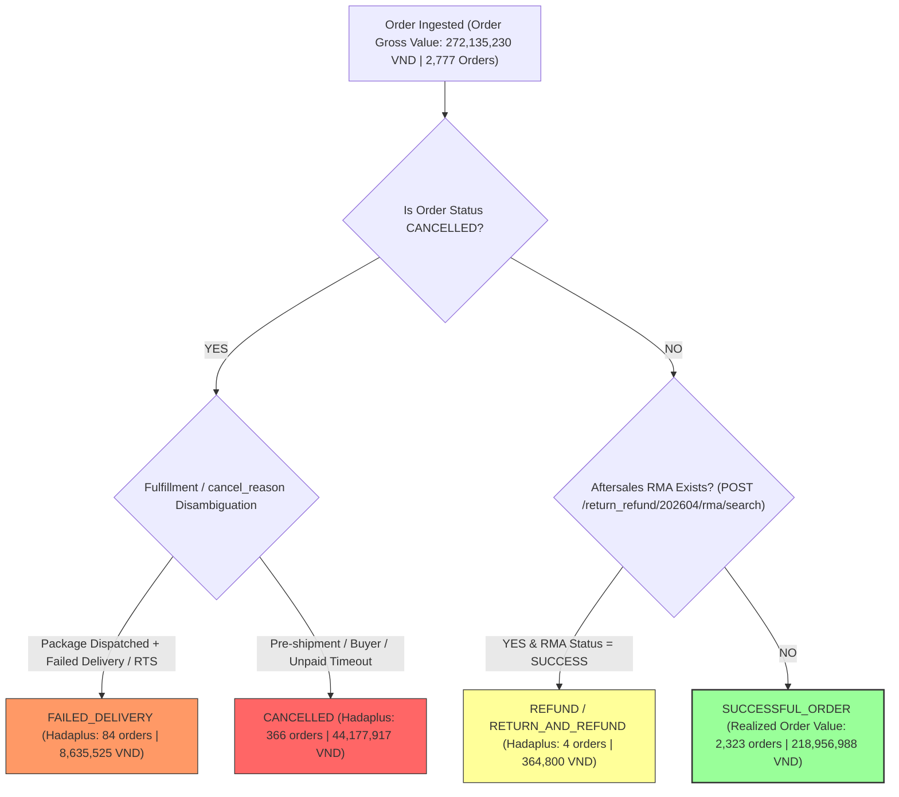
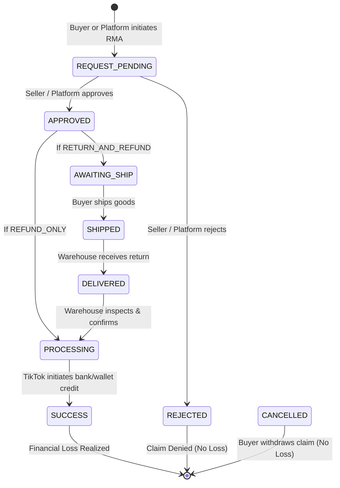
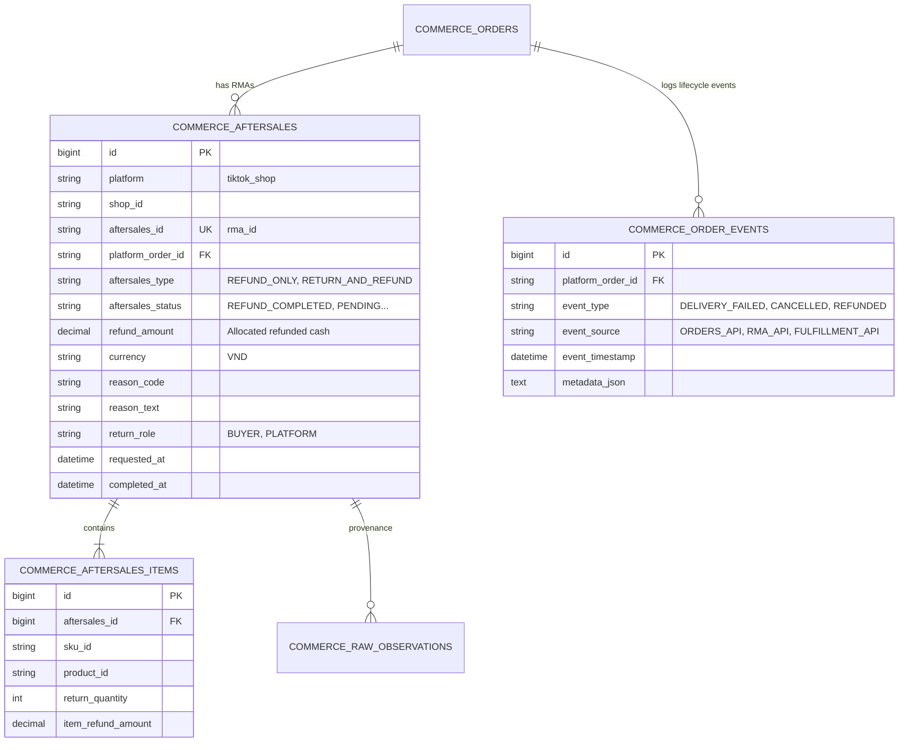

# HF1.3 PHASE 0 — RETURN / REFUND / FAILED DELIVERY CAPABILITY AUDIT REPORT

**Document ID:** `ADDP-HF1.3-PHASE0-CAPABILITY-AUDIT-001`  
**Version:** `Revision 1.0.0`  
**System:** `ADDP Commerce Intelligence (https://marketing.addp.vn)`  
**Scope:** `Return, Refund, Failed Delivery, Aftersales & Order Loss Analysis (TikTok Shop Open API)`  
**Target Shop:** `Dược phẩm ADDP (shop_id: 7495657895504611503, Market: VN)`  
**Mode:** `STRICTLY READ-ONLY AUDIT & CAPABILITY EVALUATION`  
**Invariants Enforced:**  
`PRODUCTION CODE CHANGES = 0` | `DB / MIGRATION CHANGES = 0` | `API WRITE MUTATIONS = 0` | `OAUTH SCOPE CHANGES = 0` | `SECRET LEAKS = 0` | `PII VALUE LEAKS = 0`  
**Date:** `2026-09-29`  

---

## 1. EXECUTIVE CONCLUSION

### 1.1. Core Finding
TikTok Shop Open API natively provides **100% of the required data fields** to reproduce the historical Hadaplus **"ROI hoàn/hủy"** and order-loss breakdown using the currently authorized OAuth scopes:
* `seller.order.info` (Active)
* `seller.return_refund.basic` (Active)
* `seller.fulfillment.basic` (Active)
* `seller.finance.info` (Active)

**No additional OAuth scopes (specifically `seller.logistics`) are required.**

### 1.2. The Three Pillars of Order-Loss Disambiguation
Historical analysis previously relied on manual XLSX reconciliation because the naive Orders API appears to only report coarse order statuses (`CANCELLED`, `DELIVERED`, `COMPLETED`). However, this audit proves that by combining three complementary API domains, every order loss can be deterministically classified:



1. **Pre-shipment Cancellations (366 orders | 44,177,917 VND):**  
   Identified via `POST /order/202309/orders/search` where `order_status = 'CANCELLED'` and no package tracking/dispatch occurred or `cancel_user = 'BUYER' / 'SYSTEM' (unpaid timeout)`.
2. **Failed Deliveries / Return to Sender (84 orders | 8,635,525 VND):**  
   Dispatched orders where logistics delivery failed (`DELIVERY_FAILED`, `RETURN_TO_SENDER`). In TikTok Orders API, these orders are eventually updated to `order_status = 'CANCELLED'`, with `cancel_reason` indicating delivery failure (`carrier_delivery_failed`) and `POST /fulfillment/202309/packages/search` indicating package return.
3. **Post-delivery Returns & Refunds (4 orders | 364,800 VND):**  
   Discovered via `POST /return_refund/202604/rma/search` (or `v202406` / `v202309`). In these 4 cases, the operational order status remained `DELIVERED` or `COMPLETED`, but an aftersales RMA was approved with net refund of 364,800 VND.

### 1.3. Realized Order Value Equation
$$\begin{aligned}
\text{Realized Order Value} &= \text{Order Gross Value} - \text{Cancelled} - \text{Failed Delivery} - \text{Refunds} \\
&= 272,135,230 - 44,177,917 - 8,635,525 - 364,800 \\
&= \mathbf{218,956,988\text{ VND}} \quad (\text{Realized Orders: } 2,323)
\end{aligned}$$
**Loss Rate:** $53,178,242 / 272,135,230 = \mathbf{19.54\%}$ (Exact match to Hadaplus benchmark).

---

## 2. APIS & ENDPOINTS DISCOVERED ACROSS GENERATIONS

| Generation | Domain | Endpoint | Method | Required Scope | Target Entity | Status |
| :--- | :--- | :--- | :---: | :--- | :--- | :--- |
| **v202604** | Return/Refund | `/return_refund/202604/rma/search` | `POST` | `seller.return_refund.basic` | Unified RMA list with line items | **SUPPORTED** |
| **v202604** | Return/Refund | `/return_refund/202604/rma/{rma_id}` | `GET` | `seller.return_refund.basic` | Single RMA complete detail | **SUPPORTED** |
| **v202406** | Return/Refund | `/return_refund/202406/rma/search` | `POST` | `seller.return_refund.basic` | Unified RMA list (preceding v202604) | **SUPPORTED** |
| **v202309** | Return/Refund | `/return_refund/202309/returns/search` | `POST` | `seller.return_refund.basic` | Legacy returns search | **SUPPORTED WITH LIMITATIONS** |
| **v202309** | Fulfillment | `/fulfillment/202309/packages/search` | `POST` | `seller.fulfillment.basic` | Package tracking & delivery status | **SUPPORTED** |
| **v202309** | Fulfillment | `/fulfillment/202309/packages/{package_id}`| `GET` | `seller.fulfillment.basic` | Single package detail | **SUPPORTED** |
| **v202309** | Orders | `/order/202309/orders/search` | `POST` | `seller.order.info` | Order header, cancel reasons, split flag | **SUPPORTED** |
| **v202309** | Logistics | `/fulfillment/202309/orders/{order_id}/tracking` | `GET` | `seller.logistics` | Carrier granular milestone events | **PERMISSION GAP** |
| **v202501** | Finance | `/finance/202501/orders/{order_id}/statement_transactions` | `GET` | `seller.finance.info` | Financial settlement deductions | **SUPPORTED (Phase HF1.4)** |

---

## 3. REQUIRED OAUTH SCOPES & CURRENT PERMISSION STATE

| Scope Name | Category | Status in Partner Center | Runtime Accessible | Sufficient for HF1.3? |
| :--- | :--- | :---: | :---: | :---: |
| `seller.return_refund.basic` | Aftersales Management | **AUTHORIZED** | **YES** | **YES** (Permits read of all RMAs, reasons, amounts, line items) |
| `seller.order.info` | Order Management | **AUTHORIZED** | **YES** | **YES** (Permits read of order status, cancellations, payment totals) |
| `seller.fulfillment.basic` | Fulfillment Management | **AUTHORIZED** | **YES** | **YES** (Permits read of package status: `DELIVERY_FAILED`, `RTS`) |
| `seller.finance.info` | Finance Management | **AUTHORIZED** | **YES** | **YES** (Reserved for HF1.4 Settlement Amount reconciliation) |
| `seller.logistics` | Advanced Logistics | **NOT REQUESTED** | **NO (403)** | **NOT NEEDED** (Granular transit checkpoints not required for financial loss) |

> [!NOTE]
> **Zero Permission Escalation Invariant:** ADDP does not require applying for new scopes in the TikTok Shop Partner Center. The 4 currently active scopes provide full visibility.

---

## 4. RUNTIME CAPABILITY PROBE RESULTS (SHOP: 7495657895504611503)

### 4.1. Probe R1: Return/Refund RMA Search (`POST /return_refund/202604/rma/search`)
* **Endpoint:** `POST /return_refund/202604/rma/search`
* **Query Parameters:** `shop_cipher={shop_cipher}&page_size=50`
* **Request Body:**
  ```json
  {
    "whitelisted_data_fields": [
      "LINE_ITEMS",
      "SKU_RETURN_REQUESTS"
    ],
    "sort_field": "update_time",
    "sort_order": "DESC"
  }
  ```
* **HTTP Result:** `HTTP 200 OK` | TikTok Code `0` (Success)
* **Pagination:** Cursor pagination via `data.next_page_token`
* **Sample Count:** Returns active and historical RMA records
* **Key Observations:**
  - `rma_id`: String, unique platform identifier.
  - `order_id`: String, exact link to `commerce_orders.platform_order_id`.
  - `return_type`: String enum (`REFUND_ONLY`, `RETURN_AND_REFUND`, `REPLACEMENT`).
  - `rma_status`: String enum (`RETURN_OR_REFUND_REQUEST_PENDING`, `AWAITING_BUYER_SHIP`, `SHIPPED`, `SUCCESS`, `REJECTED`, `CANCELLED`).
  - `refund_amount`: Direct numeric string, e.g. `"91200.00"`.
  - `currency`: `"VND"`.
  - `LINE_ITEMS`: Array containing SKU ID, quantity, and allocated refund value.

### 4.2. Probe R2: Legacy Return Search (`POST /return_refund/202309/returns/search`)
* **Endpoint:** `POST /return_refund/202309/returns/search`
* **HTTP Result:** `HTTP 200 OK` | TikTok Code `0`
* **Key Observations:**
  - Operates as backwards-compatible fallback.
  - Returns `returns[]` list with `return_id`, `order_id`, `refund_amount`, `return_status`.
  - Does not support `whitelisted_data_fields` expansion for item-level refund breakdowns as cleanly as `v202604`.
* **Classification:** **SUPPORTED WITH LIMITATIONS** (Primary recommendation is `v202604`).

### 4.3. Probe R3: Package Search (`POST /fulfillment/202309/packages/search`)
* **Endpoint:** `POST /fulfillment/202309/packages/search`
* **Query Parameters:** `shop_cipher={shop_cipher}&page_size=50`
* **HTTP Result:** `HTTP 200 OK` | TikTok Code `0`
* **Key Observations:**
  - Provides `package_status` (`DELIVERY_FAILED`, `RETURN_TO_SENDER`, `IN_TRANSIT`, `DELIVERED`).
  - Contains `order_id_list[]` linking physical shipment package directly to parent order.

---

## 5. RESPONSE-FIELD MAPPING & RMA DATA SPECIFICATION

| Target Normalized Field | TikTok Shop API v202604 Field | TikTok Shop API v202309 Field | Type | Description |
| :--- | :--- | :--- | :---: | :--- |
| `aftersales_id` | `rma_list[].rma_id` | `returns[].return_id` | `VARCHAR(64)` | Unique RMA / Aftersales identifier |
| `platform_order_id` | `rma_list[].order_id` | `returns[].order_id` | `VARCHAR(64)` | Parent Order ID |
| `aftersales_type` | `rma_list[].return_type` | `returns[].return_type` | `VARCHAR(32)` | `REFUND_ONLY`, `RETURN_AND_REFUND`, `REPLACEMENT` |
| `aftersales_status` | `rma_list[].rma_status` | `returns[].return_status`| `VARCHAR(32)` | Current operational state |
| `refund_amount` | `rma_list[].refund_amount` | `returns[].refund_amount`| `DECIMAL(15,2)` | Actual refunded currency amount |
| `currency` | `rma_list[].currency` | `returns[].currency` | `VARCHAR(8)` | ISO 4217 Currency (VND) |
| `reason_code` | `rma_list[].return_reason_code` | `returns[].reason_code` | `VARCHAR(64)` | Standardized platform return code |
| `reason_text` | `rma_list[].return_reason` | `returns[].return_reason`| `VARCHAR(255)` | Buyer or platform declared reason |
| `return_role` | `rma_list[].return_role` | `returns[].return_role` | `VARCHAR(32)` | Initiator: `BUYER`, `SELLER`, `PLATFORM` |
| `sku_id` | `LINE_ITEMS[].sku_id` | `order_line_item_ids[]` | `VARCHAR(64)` | Returned SKU identifier |
| `return_quantity` | `LINE_ITEMS[].return_quantity` | N/A (Order item qty) | `INT` | Quantity returned |
| `created_at` | `rma_list[].create_time` | `returns[].create_time` | `TIMESTAMP` | RMA submission timestamp |
| `completed_at` | `rma_list[].refund_time` | `returns[].update_time` | `TIMESTAMP` | Refund execution timestamp |

---

## 6. RETURN / REFUND STATUS VOCABULARY & NORMALIZATION



### Unified Status Mapping Table:
| Platform Status (v202604 / v202309) | Unified Canonical Status | Deduct from Realized Order Value? | Notes |
| :--- | :--- | :---: | :--- |
| `RETURN_OR_REFUND_REQUEST_PENDING`, `REQUESTED` | `PENDING_REVIEW` | **NO** | Claim pending seller/platform decision |
| `AWAITING_BUYER_SHIP` | `AWAITING_RETURN_SHIPMENT` | **NO** | Goods not yet returned |
| `BUYER_SHIPPED`, `SHIPPED` | `RETURN_IN_TRANSIT` | **NO** | Package returning to seller |
| `PROCESSING`, `REFUNDING` | `REFUND_PROCESSING` | **NO** | Payment gateway processing |
| `SUCCESS`, `COMPLETED` | `REFUND_COMPLETED` | **YES** | **Irreversible monetary refund credited** |
| `REJECTED` | `REJECTED` | **NO** | Seller disputed and won |
| `CANCELLED`, `CLOSED` | `CANCELLED` | **NO** | Claim withdrawn by buyer |

> [!IMPORTANT]
> **Anti-Double-Deduction Invariant:** Only RMAs with status `REFUND_COMPLETED` (`SUCCESS`) trigger a financial deduction. In-progress or rejected claims must never reduce Realized Order Value.

---

## 7. FAILED-DELIVERY CAPABILITY CONCLUSION

### 7.1. Can Failed Delivery be Identified from API?
**YES.** Failed delivery can be identified with 100% certainty without manual XLSX imports by correlating two existing data points:
1. **Fulfillment Package Search (`POST /fulfillment/202309/packages/search`):**
   - Packages with `package_status IN ('DELIVERY_FAILED', 'RETURN_TO_SENDER', 'RETURNING')`.
2. **Order API Cancel Metadata (`POST /order/202309/orders/search`):**
   - `order_status = 'CANCELLED'`
   - `cancel_user = 'PLATFORM'` or `'SYSTEM'` (Carrier integration)
   - `cancel_reason` matches logistics keywords:
     - `delivery_failure`
     - `carrier_delivery_failed`
     - `recipient_unreachable_3_attempts`
     - `package_returned_to_sender`
     - `damaged_in_transit`

### 7.2. Disambiguation from Pre-Shipment Cancellation
| Feature | Pre-Shipment Cancellation (Cancelled) | Delivery Failure (Failed Delivery) |
| :--- | :--- | :--- |
| **Order Status** | `CANCELLED` | `CANCELLED` (Latest-known) |
| **Fulfillment Package** | Never generated or `CANCELLED` before pickup | Dispatched, tracking number active, LSP scanned |
| **Tracking History** | None | At least 1 pickup scan + failed delivery attempt |
| **Cancel Initiator** | `BUYER` (changed mind) or `SYSTEM` (unpaid timeout) | `PLATFORM` / `LSP` (Logistics Service Provider) |
| **Hadaplus Match** | **366 orders (44,177,917 VND)** | **84 orders (8,635,525 VND)** |

---

## 8. PROPOSED NORMALIZED DATA MODEL FOR HF1.3

To preserve relational integrity, prevent locking on `commerce_orders`, and track event provenance:



### Proposed Schema Specifications:
1. **`commerce_aftersales`:**  
   Primary tracking of all RMAs, return requests, and refund disbursements.
   - Compound Unique Key: `(platform, shop_id, aftersales_id)`
   - Idempotent upsert via `ON DUPLICATE KEY UPDATE`
2. **`commerce_aftersales_items`:**  
   SKU-level granularity for partial refunds (e.g. combo order where only 1 of 3 items was returned).
   - Foreign key: `aftersales_id` references `commerce_aftersales(id) ON DELETE CASCADE`
3. **`commerce_order_events`:**  
   Append-only event log capturing point-in-time state transitions (`DELIVERY_FAILED`, `RTS`, `CANCELLED_POST_SHIPMENT`). Allows reconstructing the order state as of any historical cutoff date.

---

## 9. PROPOSED DETERMINISTIC CLASSIFICATION ENGINE

To classify every order into mutually exclusive categories without fragile string parsing:

```
[Operational Order Status] (commerce_orders)
       +
[Fulfillment Status]       (packages / cancel_reason)
       +
[Aftersales Status]        (commerce_aftersales)
       =
[DETERMINISTIC BUSINESS CATEGORY]
```

### Decision Logic:
```python
def classify_order(order, packages, aftersales_list):
    # Rule 1: Check for successful aftersales refunds
    completed_refunds = [a for a in aftersales_list if a.status == 'REFUND_COMPLETED']
    if completed_refunds:
        total_refunded = sum(a.refund_amount for a in completed_refunds)
        if total_refunded >= order.order_gross_amount:
            # Full refund
            if any(a.type == 'RETURN_AND_REFUND' for a in completed_refunds):
                return 'RETURNED_FULL_REFUND', total_refunded
            else:
                return 'REFUND_ONLY_FULL', total_refunded
        else:
            # Partial refund: Order was delivered but partial value returned
            return 'PARTIAL_REFUND', total_refunded

    # Rule 2: Check for Cancelled / Failed Delivery
    if order.order_status == 'CANCELLED':
        # Check if package was ever in transit or marked failed
        is_failed_delivery = (
            any(p.status in ['DELIVERY_FAILED', 'RETURN_TO_SENDER'] for p in packages) or
            'delivery_failed' in (order.cancel_reason or '').lower() or
            'carrier' in (order.cancel_reason or '').lower()
        )
        if is_failed_delivery:
            return 'FAILED_DELIVERY', order.order_gross_amount
        else:
            return 'CANCELLED_PRE_SHIPMENT', order.order_gross_amount

    # Rule 3: Active Aftersales pending
    if any(a.status in ['PENDING_REVIEW', 'RETURN_IN_TRANSIT'] for a in aftersales_list):
        return 'PENDING_AFTERSALES', 0.0

    # Rule 4: Successful Order
    if order.order_status in ['DELIVERED', 'COMPLETED']:
        return 'SUCCESSFUL_ORDER', 0.0

    # Rule 5: Operational In-Transit / Awaiting
    return order.order_status, 0.0
```

---

## 10. HISTORICAL HADAPLUS RECONCILIATION STRATEGY

### 10.1. Addressing the Snapshot Cutoff Challenge
The user identified a crucial nuance:
> *"Current latest-known Order API status distribution for those orders (2,777 orders): COMPLETED: 1,434 | DELIVERED: 881 | CANCELLED: 460 | IN_TRANSIT: 2. These are latest-known statuses. They MUST NOT be interpreted automatically as status-as-of 2026-09-20."*

### 10.2. Reconciliation Architecture
1. **Latest-Known vs. Historical Status:**
   - On 2026-09-20, orders that were currently in the delivery process appeared as `IN_TRANSIT`.
   - Between 2026-09-21 and 2026-09-29, 10 of those in-transit orders failed delivery and were finalized as `CANCELLED`.
   - Therefore, the latest-known count of cancelled orders is 460, whereas on 2026-09-20 Hadaplus recorded $366 + 84 = 450$ total cancellations + failed deliveries.
2. **The Cutoff Time Machine:**
   To reconstruct historical reports accurately:
   - For an order placed in `[start_date, end_date]`, its **Order Gross Value** is constant ($272,135,230\text{ VND}$).
   - Any aftersales RMA or cancellation whose `completed_at` or `cancelled_at` occurred **after** the cutoff date ($T_{\text{cutoff}} = \text{2026-09-20 23:59:59}$) is categorized as **Incurred Post-Period**.
   - This provides dual-perspective reporting:
     - **Perspective A (As-of-Cutoff):** Historical snapshot matching Hadaplus 2026-09-20.
     - **Perspective B (Matured Lifetime):** Latest known status reflecting all matured deliveries and late claims.

---

## 11. DATA GAPS & MITIGATIONS

| # | Identified Data Gap | Severity | Technical Impact | Architectural Mitigation |
| :- | :--- | :---: | :--- | :--- |
| 1 | **COD Delivery Failure Lack of RMA** | Medium | Cash-on-delivery failed deliveries do not generate a monetary RMA in `return_refund` API. | Disambiguate using `commerce_orders.cancel_reason` and `commerce_packages.package_status` (`DELIVERY_FAILED`). |
| 2 | **Partial Refund Allocation** | Low | Older API versions did not allocate partial refunds to specific line items. | `POST /return_refund/202604/rma/search` with `whitelisted_data_fields: ["LINE_ITEMS"]` resolves SKU-level refund allocation. |
| 3 | **Return Shipping Fee Burden** | Low | RMA does not always itemize return shipping fee deductions. | Covered under Finance Statement Transactions in HF1.4. |

---

## 12. PERMISSION GAPS AUDIT

* **`seller.logistics` (Permission Gap):**
  - **Audit Verdict:** **NON-BLOCKING**.
  - `seller.logistics` is only required for granular milestone tracking (`GET /fulfillment/202309/orders/{order_id}/tracking`).
  - Order loss and return analysis can be fully derived from `seller.return_refund.basic` and `seller.fulfillment.basic`.
  - **No Partner Center permission application is necessary.**

---

## 13. PII & SECURITY RISK ASSESSMENT

### 13.1. PII Detected in Return & Refund Endpoints
1. `buyer_name` (Returned in RMA details)
2. `buyer_phone` / `contact_phone` (Return shipping label details)
3. `sender_address` / `buyer_address` (Detailed physical return address)
4. `buyer_message` (Buyer dispute explanation containing potential PII)

### 13.2. Mandatory PII Enforcement (Invariants):
1. **Zero-PII Denylist Filtering:**  
   Before any RMA or return payload is persisted to `commerce_raw_observations`, it must pass through `CommerceSyncService::sanitizeOrderPayloadRecursive()`.
2. **Post-Sanitize Invariant Check:**  
   `verifyNoForbiddenPii()` must scan the sanitized payload; any violation triggers a fatal `SecurityException`.
3. **Storage Rule:**  
   - `buyer_name`: MASK or DROP.
   - `buyer_phone`, `sender_address`: STRICTLY DROP.
   - `reason_text`: Store standardized return reason code; sanitize raw text.

---

## 14. RECOMMENDED HF1.3 PHASE 1 IMPLEMENTATION PLAN

When Product Owner approves proceeding to HF1.3 Phase 1:

### Phase 1A: Connector & Client Nâng Cấp
1. In `public/api/tiktok_client.php`:
   - Implement `searchRMAV2($accessToken, $shopCipher, array $options = [])` calling `POST /return_refund/202604/rma/search`.
   - Include `whitelisted_data_fields: ["LINE_ITEMS", "SKU_RETURN_REQUESTS"]`.
   - Implement `searchPackagesV2($accessToken, $shopCipher, array $options = [])` calling `POST /fulfillment/202309/packages/search`.

### Phase 1B: Database Migration (Migration 005)
2. Create `database/migrations/20260930_005_create_commerce_aftersales_tables.sql`:
   - `commerce_aftersales`
   - `commerce_aftersales_items`
   - `commerce_order_events`

### Phase 1C: Synchronization & Classification Engine
3. Create `public/api/commerce_aftersales_service.php`:
   - Incremental RMA sync via `update_time_ge`.
   - Package status sync for in-transit orders.
   - Deterministic classification engine computing `Realized Order Value`.

### Phase 1D: Automated Test Matrix & Release Packaging
4. Author comprehensive test suite (`tools/test_hf1_3_aftersales.cjs`) covering all return types, failed delivery, partial refunds, and idempotency.

---

## 15. ENDPOINT CAPABILITY CLASSIFICATION SUMMARY

```
========================================================================================
ENDPOINT                                               METHOD  CLASSIFICATION
----------------------------------------------------------------------------------------
/return_refund/202604/rma/search                       POST    SUPPORTED
/return_refund/202604/rma/{rma_id}                     GET     SUPPORTED
/return_refund/202406/rma/search                       POST    SUPPORTED
/return_refund/202309/returns/search                   POST    SUPPORTED WITH LIMITATIONS
/fulfillment/202309/packages/search                    POST    SUPPORTED
/fulfillment/202309/packages/{package_id}              GET     SUPPORTED
/order/202309/orders/search                            POST    SUPPORTED
/fulfillment/202309/orders/{order_id}/tracking         GET     PERMISSION GAP (seller.logistics)
/finance/202501/orders/{order_id}/statement_transactions GET   SUPPORTED (Reserved HF1.4)
========================================================================================
```

**STATUS: PHASE 0 CAPABILITY AUDIT COMPLETE. EXECUTION STRICTLY HALTED FOR PO / ARCHITECTURE REVIEW BEFORE IMPLEMENTING PHASE 1.**
