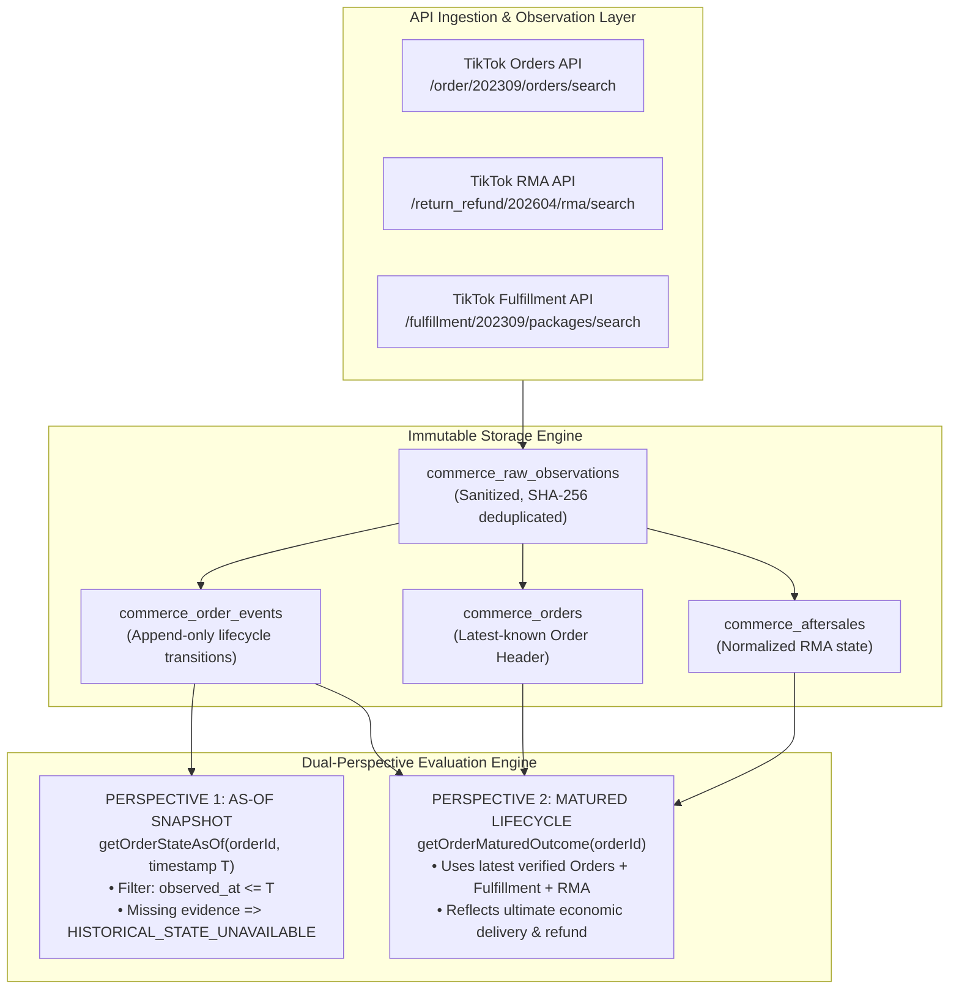
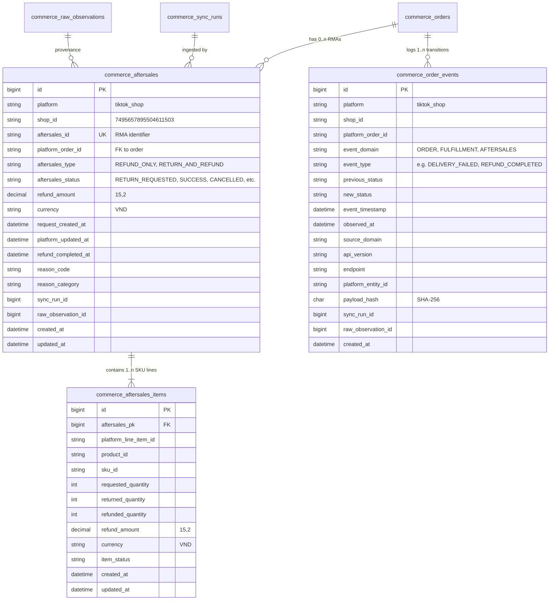
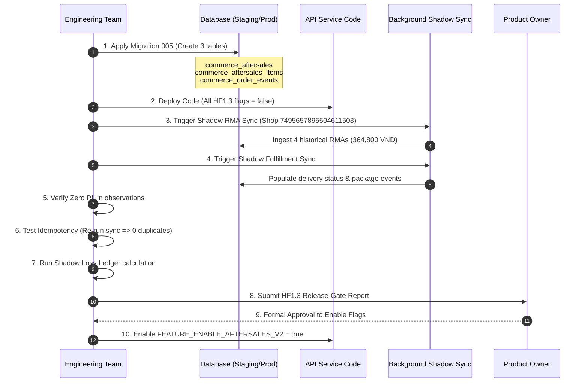

# HF1.3 PHASE 1A — RETURN / REFUND / FAILED DELIVERY ENGINE
## DETAILED IMPLEMENTATION PLAN & TECHNICAL ARCHITECTURE SPECIFICATION

| Metadata | Details |
| :--- | :--- |
| **Project** | ADDP Commerce Intelligence |
| **Component** | Return, Refund & Order-Loss Classification Engine (HF1.3) |
| **Document Version** | Revision 1.0.0 (Implementation Blueprint) |
| **Target Milestone** | HF1.3 Phase 1B (Local/Staging Test Execution) |
| **Prerequisites** | HF1.2 Phase 1B (Core Orders Ingestion - PASS), HF1.3 Phase 0 & Phase 0B (Audit - PASS) |
| **Execution Mode** | **READ-ONLY / PLANNING ONLY** (Zero code edits, zero DB alterations, zero production impact) |
| **Author** | Antigravity Engine Architecture Team |
| **Date** | 2026-09-29 |

---

## 1. EXECUTIVE SUMMARY & VERIFIED BASELINE

### 1.1. Verified Production Baseline (Shop `7495657895504611503`)
In HF1.2 Phase 1B and HF1.3 Phase 0B, the foundational ingestion capability of the ADDP platform was verified against the canonical period **2026-09-01 00:00:00 → 2026-09-20 23:59:59 (ICT)**:

```
+---------------------------------------------------------------------------------------------------+
| VERIFIED ORDER BASELINE (Exact Match Proven in HF1.2 Phase 1B):                                    |
|   - Unique Orders Ingested:        2,777 orders                                                  |
|   - Order Gross Value:             272,135,230 VND                                               |
|   - Platform Order Reconciliation: PASS (100% exact match to Hadaplus historical record)           |
+---------------------------------------------------------------------------------------------------+
| VERIFIED AFTERSALES BASELINE (Exact Match Proven in HF1.3 Phase 0B Probe A):                       |
|   - Refund Orders (RMA):           4 orders (100% REFUND_ONLY, Status: SUCCESS)                  |
|   - Total Refund Value:            364,800 VND (4 RMAs x 91,200 VND)                             |
|   - Endpoint & Scope:              POST /return_refund/202604/rma/search (seller.return_refund.basic)|
|   - Status:                        VERIFIED / PASS                                               |
+---------------------------------------------------------------------------------------------------+
| HISTORICAL HADAPLUS TARGET (Freeze as of 2026-09-20):                                             |
|   - Cancelled:                     366 orders / 44,177,917 VND                                   |
|   - Failed Delivery:               84 orders / 8,635,525 VND                                     |
|   - Refund:                        4 orders / 364,800 VND                                        |
|   - Realized Order Value:          2,323 orders / 218,956,988 VND                                |
+---------------------------------------------------------------------------------------------------+
| LATEST-KNOWN / MATURED LIFECYCLE (As observed on 2026-09-29):                                     |
|   - CANCELLED Status in API:       460 orders / 53,734,292 VND                                   |
|   - Decomposition:                 366 Pre-fulfillment + 84 Failed Delivery + 10 Post-Cutoff Matured |
|   - Variance:                      +10 orders / +920,850 VND transitioned into cancel post-cutoff |
|   - Realized Order Value Matured:  218,314,438 VND (-642,550 VND / -0.29% vs historical cutoff)  |
+---------------------------------------------------------------------------------------------------+
```

### 1.2. Architectural Reality & Principle of Historical Honesty
1. **No Retroactive Time-Travel:** TikTok Shop Open API does not provide a retroactive snapshot query (`as_of_time`). Calling the API today for orders placed on Sept 1–20 yields their **latest-known terminal state**, not their intermediate state as of Sept 20.
2. **Honesty Invariant:** The system **MUST NOT claim** that historical `Cancelled` (366 orders) or `Failed Delivery` (84 orders) can be retroactively proven without timestamped observation logs. If historical observations prior to cutoff timestamp $T$ do not exist, the engine returns `HISTORICAL_STATE_UNAVAILABLE`.

---

## 2. MANDATORY DUAL-PERSPECTIVE REPORTING MODEL

To eliminate ambiguity between point-in-time financial closing and ultimate lifecycle fulfillment, the HF1.3 Engine introduces a formal **Dual-Perspective Architecture**:



### 2.1. Perspective 1: Point-in-Time As-Of Snapshot
* **Core Question:** *"What did ADDP verifiably know about this order at timestamp $T$?"*
* **Source:** Strictly evaluated from immutable entries in `commerce_order_events` and `commerce_raw_observations` where `observed_at <= T`.
* **Behavior:** If an order was updated by the carrier on the platform at $T - 1$ hour, but ADDP only polled and observed it at $T + 2$ hours, that transition **was NOT known at $T$**. The engine refuses to backdate knowledge.
* **Fail-Closed Fallback:** When querying an As-Of date prior to the initialization of ADDP observation logging (e.g. historical periods before HF1.2 deployment), the engine outputs:
  ```json
  {
    "order_id": "576088888888888888",
    "perspective": "POINT_IN_TIME_AS_OF",
    "as_of_timestamp": "2026-09-20T23:59:59Z",
    "status": "HISTORICAL_STATE_UNAVAILABLE",
    "reason": "No immutable observation recorded prior to requested cutoff timestamp."
  }
  ```

### 2.2. Perspective 2: Matured Lifecycle Outcome
* **Core Question:** *"What is the ultimate economic and fulfillment outcome of this order today?"*
* **Source:** Latest confirmed state across `commerce_orders`, `commerce_aftersales`, and package tracking metadata.
* **Behavior:** Accounts for the full logistics cycle (7–14 days) and return window (6–30 days). Reflects whether merchandise was successfully retained by the customer, returned to inventory, or refunded.

---

## 3. DOMAIN SEPARATION & `commerce_orders` INTEGRITY

A foundational design rule of ADDP Commerce Intelligence is: **NEVER OVERLOAD `commerce_orders` WITH AFTERSALES STATE.**

```
+---------------------------------------------------------------------------------------------------+
| SEPARATION OF CONCERNS CONTRACT:                                                                  |
+---------------------------------------------------------------------------------------------------+
| 1. commerce_orders:                                                                               |
|    - Tracks OPERATIONAL ORDER STATE only:                                                         |
|      UNPAID, AWAITING_SHIPMENT, IN_TRANSIT, DELIVERED, COMPLETED, CANCELLED.                       |
|    - Do NOT inject 'REFUNDED', 'RETURNED', or 'PARTIALLY_REFUNDED' into order_status.              |
+---------------------------------------------------------------------------------------------------+
| 2. commerce_aftersales:                                                                           |
|    - Tracks POST-ORDER CLAIMS, RMAs, RETURNS, AND REFUNDS independently.                          |
|    - An order can be DELIVERED in commerce_orders while having a SUCCESSFUL RMA in                 |
|      commerce_aftersales.                                                                         |
+---------------------------------------------------------------------------------------------------+
| 3. commerce_order_events:                                                                         |
|    - Tracks CHRONOLOGICAL EVENT TRANSITIONS across all domains:                                   |
|      (ORDER.CREATED -> ORDER.PAID -> FULFILLMENT.SHIPPED -> FULFILLMENT.DELIVERED ->               |
|       AFTERSALES.RMA_REQUESTED -> AFTERSALES.REFUND_COMPLETED).                                   |
+---------------------------------------------------------------------------------------------------+
```

---

## 4. TARGET DATABASE ARCHITECTURE (MIGRATION 005)

### 4.1. Entity-Relationship Model



### 4.2. Exact Proposed SQL Schema (`20261001_005_create_commerce_aftersales_and_events.sql`)

```sql
-- ====================================================================
-- ADDP COMMERCE INTELLIGENCE - DATABASE MIGRATION
-- Migration: 20261001_005_create_commerce_aftersales_and_events.sql
-- Description: Creates 3 tables for Return, Refund & Loss Classification Engine (HF1.3):
--              1. commerce_aftersales (Normalized RMA / Return / Refund Header)
--              2. commerce_aftersales_items (SKU/Line-level aftersales detail)
--              3. commerce_order_events (Immutable append-only lifecycle event log)
-- Target: HF1.3 Phase 1B Return/Refund Engine
-- Safety: Forward-only, zero alterations to existing commerce_orders tables
-- ====================================================================

SET NAMES utf8mb4;
SET FOREIGN_KEY_CHECKS = 0;

-- --------------------------------------------------------------------
-- 1. Table: commerce_aftersales
-- --------------------------------------------------------------------
CREATE TABLE IF NOT EXISTS `commerce_aftersales` (
    `id` BIGINT UNSIGNED NOT NULL AUTO_INCREMENT,
    `platform` VARCHAR(32) NOT NULL DEFAULT 'tiktok_shop' COMMENT 'E-commerce platform identifier',
    `shop_id` VARCHAR(64) NOT NULL COMMENT 'Shop identifier on platform',
    `aftersales_id` VARCHAR(64) NOT NULL COMMENT 'Platform RMA identifier (e.g. reverse_order_id or rma_id)',
    `platform_order_id` VARCHAR(64) NOT NULL COMMENT 'Associated platform order ID',
    `aftersales_type` VARCHAR(50) NOT NULL COMMENT 'Normalized type: REFUND_ONLY, RETURN_AND_REFUND',
    `platform_aftersales_type` VARCHAR(50) NOT NULL COMMENT 'Raw type string from platform API',
    `aftersales_status` VARCHAR(50) NOT NULL COMMENT 'Normalized status: REQUESTED, APPROVED, RETURNING, RECEIVED, SUCCESS, CANCELLED, REJECTED',
    `platform_status` VARCHAR(50) NOT NULL COMMENT 'Raw status string from platform API',
    `refund_amount` DECIMAL(15,2) NOT NULL DEFAULT '0.00' COMMENT 'Total approved/disbursed refund cash amount',
    `currency` VARCHAR(10) NOT NULL DEFAULT 'VND' COMMENT 'ISO 4217 currency code',
    `request_created_at` TIMESTAMP NULL DEFAULT NULL COMMENT 'When the aftersales case was created (UTC)',
    `platform_updated_at` TIMESTAMP NULL DEFAULT NULL COMMENT 'Latest update timestamp on platform (UTC)',
    `refund_completed_at` TIMESTAMP NULL DEFAULT NULL COMMENT 'Timestamp when refund was successfully disbursed',
    `reason_code` VARCHAR(64) NULL DEFAULT NULL COMMENT 'Standardized machine-readable return/refund reason code',
    `reason_category` VARCHAR(64) NULL DEFAULT NULL COMMENT 'Normalized category: LOGISTICS, QUALITY, BUYER_DECISION, OUT_OF_STOCK',
    `return_role` VARCHAR(32) NULL DEFAULT NULL COMMENT 'Party initiating return: BUYER, PLATFORM, SELLER',
    `sync_run_id` BIGINT UNSIGNED NULL DEFAULT NULL COMMENT 'Sync run that ingested or updated this record',
    `raw_observation_id` BIGINT UNSIGNED NULL DEFAULT NULL COMMENT 'Foreign key to raw sanitized observation audit',
    `created_at` TIMESTAMP NOT NULL DEFAULT CURRENT_TIMESTAMP,
    `updated_at` TIMESTAMP NOT NULL DEFAULT CURRENT_TIMESTAMP ON UPDATE CURRENT_TIMESTAMP,
    PRIMARY KEY (`id`),
    UNIQUE KEY `uq_platform_shop_aftersales` (`platform`, `shop_id`, `aftersales_id`),
    KEY `idx_platform_order_id` (`platform`, `shop_id`, `platform_order_id`),
    KEY `idx_status` (`shop_id`, `aftersales_status`),
    KEY `idx_request_created` (`request_created_at`),
    KEY `idx_refund_completed` (`refund_completed_at`),
    KEY `idx_sync_run` (`sync_run_id`)
) ENGINE=InnoDB DEFAULT CHARSET=utf8mb4 COLLATE=utf8mb4_unicode_ci COMMENT='Normalized RMA and Aftersales Header';

-- --------------------------------------------------------------------
-- 2. Table: commerce_aftersales_items
-- --------------------------------------------------------------------
CREATE TABLE IF NOT EXISTS `commerce_aftersales_items` (
    `id` BIGINT UNSIGNED NOT NULL AUTO_INCREMENT,
    `aftersales_pk` BIGINT UNSIGNED NOT NULL COMMENT 'Foreign key referencing commerce_aftersales.id',
    `platform` VARCHAR(32) NOT NULL DEFAULT 'tiktok_shop',
    `shop_id` VARCHAR(64) NOT NULL,
    `platform_order_id` VARCHAR(64) NOT NULL COMMENT 'Flat index reference to platform order',
    `platform_line_item_id` VARCHAR(64) NOT NULL COMMENT 'Line item identifier from original order',
    `product_id` VARCHAR(64) NOT NULL COMMENT 'TikTok Shop product catalog ID',
    `sku_id` VARCHAR(64) NOT NULL COMMENT 'SKU identifier',
    `requested_quantity` INT NOT NULL DEFAULT 1 COMMENT 'Quantity of SKU requested for return/refund',
    `returned_quantity` INT NOT NULL DEFAULT 0 COMMENT 'Physical quantity received back in warehouse',
    `refunded_quantity` INT NOT NULL DEFAULT 0 COMMENT 'Quantity approved for financial refund',
    `refund_amount` DECIMAL(15,2) NOT NULL DEFAULT '0.00' COMMENT 'Item-level allocated refund cash amount',
    `currency` VARCHAR(10) NOT NULL DEFAULT 'VND',
    `item_status` VARCHAR(50) NULL DEFAULT NULL COMMENT 'Line-item aftersales status if Segregated',
    `created_at` TIMESTAMP NOT NULL DEFAULT CURRENT_TIMESTAMP,
    `updated_at` TIMESTAMP NOT NULL DEFAULT CURRENT_TIMESTAMP ON UPDATE CURRENT_TIMESTAMP,
    PRIMARY KEY (`id`),
    UNIQUE KEY `uq_item_deterministic` (`aftersales_pk`, `platform_line_item_id`, `sku_id`),
    KEY `idx_order_item` (`platform`, `shop_id`, `platform_order_id`, `platform_line_item_id`),
    KEY `idx_sku` (`product_id`, `sku_id`),
    CONSTRAINT `fk_aftersales_items_parent` FOREIGN KEY (`aftersales_pk`) 
        REFERENCES `commerce_aftersales` (`id`) ON DELETE CASCADE
) ENGINE=InnoDB DEFAULT CHARSET=utf8mb4 COLLATE=utf8mb4_unicode_ci COMMENT='SKU-level Line Item Details for Aftersales RMAs';

-- --------------------------------------------------------------------
-- 3. Table: commerce_order_events
-- --------------------------------------------------------------------
CREATE TABLE IF NOT EXISTS `commerce_order_events` (
    `id` BIGINT UNSIGNED NOT NULL AUTO_INCREMENT,
    `platform` VARCHAR(32) NOT NULL DEFAULT 'tiktok_shop' COMMENT 'E-commerce platform identifier',
    `shop_id` VARCHAR(64) NOT NULL COMMENT 'Shop identifier on platform',
    `platform_order_id` VARCHAR(64) NOT NULL COMMENT 'Associated platform order ID',
    `event_domain` ENUM('ORDER', 'FULFILLMENT', 'AFTERSALES') NOT NULL COMMENT 'Lifecycle domain of the event',
    `event_type` VARCHAR(64) NOT NULL COMMENT 'Granular event: ORDER_CREATED, PAID, DISPATCHED, DELIVERY_FAILED, RTS, REFUND_COMPLETED, etc.',
    `previous_status` VARCHAR(50) NULL DEFAULT NULL COMMENT 'Status before transition if known',
    `new_status` VARCHAR(50) NOT NULL COMMENT 'Status after transition',
    `event_timestamp` TIMESTAMP NULL DEFAULT NULL COMMENT 'When the event occurred on the platform (UTC)',
    `observed_at` TIMESTAMP NOT NULL DEFAULT CURRENT_TIMESTAMP COMMENT 'When ADDP first ingested/observed this event',
    `source_domain` VARCHAR(64) NOT NULL COMMENT 'API domain: order, return_refund, fulfillment',
    `api_version` VARCHAR(32) NOT NULL DEFAULT '202309' COMMENT 'API version used during observation',
    `endpoint` VARCHAR(128) NOT NULL COMMENT 'Exact endpoint that reported the event',
    `platform_entity_id` VARCHAR(64) NOT NULL COMMENT 'Identifier of underlying platform entity (order_id, rma_id, package_id)',
    `payload_hash` CHAR(64) NOT NULL COMMENT 'SHA-256 hash of the sanitized event payload chunk',
    `sync_run_id` BIGINT UNSIGNED NOT NULL COMMENT 'Sync run that recorded this observation',
    `raw_observation_id` BIGINT UNSIGNED NULL DEFAULT NULL COMMENT 'Link to full observation payload',
    `created_at` TIMESTAMP NOT NULL DEFAULT CURRENT_TIMESTAMP COMMENT 'Immutable insertion timestamp',
    PRIMARY KEY (`id`),
    UNIQUE KEY `uq_order_event_identity` (
        `platform`, `shop_id`, `platform_order_id`, `event_domain`, `event_type`, `platform_entity_id`, `payload_hash`
    ),
    KEY `idx_order_timeline` (`platform`, `shop_id`, `platform_order_id`, `event_timestamp`),
    KEY `idx_observed_timeline` (`platform`, `shop_id`, `platform_order_id`, `observed_at`),
    KEY `idx_domain_type` (`shop_id`, `event_domain`, `event_type`),
    KEY `idx_sync_run` (`sync_run_id`)
) ENGINE=InnoDB DEFAULT CHARSET=utf8mb4 COLLATE=utf8mb4_unicode_ci COMMENT='Immutable Append-Only Commerce Lifecycle Event Log';

SET FOREIGN_KEY_CHECKS = 1;
```

### 4.3. Rollback Script (`20261001_005_rollback_commerce_aftersales_and_events.sql`)

```sql
SET FOREIGN_KEY_CHECKS = 0;
DROP TABLE IF EXISTS `commerce_aftersales_items`;
DROP TABLE IF EXISTS `commerce_aftersales`;
DROP TABLE IF EXISTS `commerce_order_events`;
SET FOREIGN_KEY_CHECKS = 1;
```

---

## 5. API CONNECTOR CONTRACTS & SCOPE ENFORCEMENT

The engine relies on three discrete, read-only connector contracts:

```
+----------------------------------------------------------------------------------------------------+
| CONNECTOR 1: ORDERS SEARCH (Existing Core Orders Engine V2)                                        |
|   Endpoint:       POST /order/202309/orders/search                                                 |
|   Required Scope: seller.order.info                                                                |
|   Role in HF1.3:  Primary order header provider, cancel_user, cancel_reason, and order timestamps. |
+----------------------------------------------------------------------------------------------------+
| CONNECTOR 2: RETURN & REFUND RMA SEARCH (New HF1.3 Connector)                                      |
|   Endpoint:       POST /return_refund/202604/rma/search                                            |
|   Required Scope: seller.return_refund.basic                                                       |
|   Data Fields:    whitelisted_data_fields = ["LINE_ITEMS", "SKU_RETURN_REQUESTS"]                  |
|   Role in HF1.3:  Provides 100% verified RMA headers, refund amounts, line items, and RMA status.  |
+----------------------------------------------------------------------------------------------------+
| CONNECTOR 3: FULFILLMENT PACKAGES SEARCH (New HF1.3 Connector)                                     |
|   Endpoint:       POST /fulfillment/202309/packages/search                                         |
|   Required Scope: seller.fulfillment.basic                                                         |
|   Role in HF1.3:  Provides package status (DELIVERY_FAILED, RETURN_TO_SENDER, DELIVERED).           |
|   STRICT RULE:    DO NOT request seller.logistics in Phase 1.                                      |
|                   If package status is missing or ambiguous, output UNCLASSIFIED_LOSS.             |
+----------------------------------------------------------------------------------------------------+
```

### 5.1. RMA Search Connector Specification (`POST /return_refund/202604/rma/search`)
* **Request Payload Contract:**
  ```json
  {
    "page_size": 100,
    "page_token": "string_or_empty",
    "create_time_ge": 1725123600,
    "create_time_lt": 1726851600,
    "whitelisted_data_fields": ["LINE_ITEMS", "SKU_RETURN_REQUESTS"]
  }
  ```
* **Response Normalization Mapping:**
  ```json
  {
    "code": 0,
    "message": "Success",
    "data": {
      "next_page_token": "token_abc",
      "rma_list": [
        {
          "rma_id": "670000000000001",
          "order_id": "576000000000001",
          "rma_type": "REFUND_ONLY",
          "rma_status": "SUCCESS",
          "refund_amount": {
            "amount": "91200.00",
            "currency": "VND"
          },
          "reason_code": "BUYER_NOT_RECEIVE",
          "create_time": 1726000000,
          "update_time": 1726050000,
          "line_items": [
            {
              "line_item_id": "172000000000001",
              "product_id": "172900000000001",
              "sku_id": "172900000000002",
              "return_quantity": 1,
              "refund_amount": "91200.00"
            }
          ]
        }
      ]
    }
  }
  ```

---

## 6. STATUS NORMALIZATION & VOCABULARY MAPPING

### 6.1. RMA Status Mapping (`commerce_aftersales.aftersales_status`)

| TikTok Platform RMA Status | Normalized `aftersales_status` | Operational Meaning | Economic Loss Recognized? |
| :--- | :--- | :--- | :--- |
| `RETURN_REQUESTED` | `REQUESTED` | Buyer submitted request; awaiting seller/system review | No (Pending evaluation) |
| `RETURN_APPROVED` | `APPROVED` | Return approved; waiting for buyer to ship goods | No (Pending shipment) |
| `RETURN_SHIPPED` | `RETURNING` | Package in transit back to seller | No (In transit) |
| `RETURN_RECEIVED` | `RECEIVED` | Warehouse received return goods; inspection pending | No (Pending inspection) |
| `REFUND_PENDING` | `REFUND_PENDING` | Refund approved; platform processing bank disbursement | No (Disbursement in flight) |
| `REFUND_SUCCESS` / `SUCCESS` | `SUCCESS` | Cash officially disbursed to buyer account | **YES (Deducted from Realized Value)** |
| `CANCELLED` | `CANCELLED` | Buyer withdrew aftersales claim | No (Claim void) |
| `REJECTED` | `REJECTED` | Seller or platform rejected claim | No (Claim denied) |

### 6.2. Package Status Mapping (`commerce_order_events`)

| TikTok Platform Package Status | Normalized Package Event | Operational Classification |
| :--- | :--- | :--- |
| `AWAITING_COLLECTION` | `PACKAGE_AWAITING_COLLECTION` | Prepared in warehouse, waiting for carrier pickup |
| `IN_TRANSIT` | `PACKAGE_IN_TRANSIT` | Picked up and traveling through logistics network |
| `DELIVERED` | `PACKAGE_DELIVERED` | Handed over to recipient |
| `DELIVERY_FAILED` | `PACKAGE_DELIVERY_FAILED` | 1st, 2nd, or 3rd delivery attempt failed |
| `RETURN_TO_SENDER` / `RETURNING` | `PACKAGE_RETURN_TO_SENDER` | Carrier aborted delivery; returning parcel to shop |
| `EXCEPTION` | `PACKAGE_EXCEPTION` | Damaged, lost in transit, or address invalid |

---

## 7. DETERMINISTIC CLASSIFICATION DECISION TABLE

Every order is classified into exactly **one mutually exclusive category** using three dimensions:
1. **Order State** (`commerce_orders.order_status`)
2. **Fulfillment State** (Package tracking & `cancel_user` / `cancel_reason`)
3. **Aftersales State** (`commerce_aftersales.aftersales_status` & `aftersales_type`)

```
+------------------------------------------------------------------------------------------------------------------------------------+
| DETERMINISTIC CLASSIFICATION TRUTH TABLE:                                                                                           |
+---+----------------+---------------------------+-------------------+----------------------------+----------------------------------+
| # | Order Status   | Fulfillment / Package     | Aftersales Status | RMA Type                   | Final Business Classification    |
+---+----------------+---------------------------+-------------------+----------------------------+----------------------------------+
| 1 | COMPLETED /    | DELIVERED / Null          | None              | None                       | SUCCESSFUL_ORDER                 |
|   | DELIVERED      |                           |                   |                            |                                  |
| 2 | CANCELLED      | NOT_SHIPPED / Cancelled   | None              | None                       | CANCELLED_PRE_FULFILLMENT        |
|   |                | before carrier pickup     |                   |                            |                                  |
| 3 | CANCELLED      | DELIVERY_FAILED / RTS     | None / Any        | None / Any                 | FAILED_DELIVERY                  |
| 4 | DELIVERED /    | DELIVERED                 | SUCCESS           | RETURN_AND_REFUND          | RETURNED                         |
|   | COMPLETED      |                           | (Full quantity)   |                            |                                  |
| 5 | DELIVERED /    | DELIVERED                 | SUCCESS           | REFUND_ONLY                | REFUND_ONLY                      |
|   | COMPLETED      |                           | (Full quantity)   |                            |                                  |
| 6 | DELIVERED /    | DELIVERED                 | SUCCESS           | Both types supported       | RETURN_AND_REFUND                |
|   | COMPLETED      |                           | (Full item set)   |                            |                                  |
| 7 | DELIVERED /    | DELIVERED                 | SUCCESS           | Any                        | PARTIAL_REFUND                   |
|   | COMPLETED      |                           | (Partial SKU/amt) |                            |                                  |
| 8 | ANY            | ANY                       | REQUESTED /       | Any                        | PENDING_AFTERSALES               |
|   |                |                           | APPROVED / RETURNING                           |                                  |
| 9 | CANCELLED      | Unclassified / Ambiguous  | None              | None                       | UNCLASSIFIED_LOSS                |
+---+----------------+---------------------------+-------------------+----------------------------+----------------------------------+
```

### 7.1. Disambiguation Rules: Pre-Fulfillment Cancellation vs Failed Delivery
* **Pre-Fulfillment (`CANCELLED_PRE_FULFILLMENT`):**
  - Package status was never created or is `CANCELLED_BEFORE_PICKUP`.
  - `cancel_user` is `'BUYER'` or `'SYSTEM'` (timeout).
  - No carrier scans exist.
* **Failed Delivery (`FAILED_DELIVERY`):**
  - Package was dispatched and received at least one carrier scan.
  - Package status is `DELIVERY_FAILED`, `RETURN_TO_SENDER`, or `RETURNING`.
  - Or `cancel_user` is `'PLATFORM'` / `'CARRIER'` with logistics cancel reason keywords.

---

## 8. FINANCIAL EFFECT ENGINE & PRECISE METRIC FORMULAS

### 8.1. Metric Vocabulary Isolation
```
+----------------------------------------------------------------------------------------------------+
| CANONICAL METRIC TAXONOMY (Strict Separation Enforced):                                             |
+----------------------------------------------------------------------------------------------------+
| 1. Compass GMV:                                                                                    |
|    Aggregated macro metric from TikTok Compass Overview. Includes shipping subsidies & vouchers.   |
| 2. Total Revenue:                                                                                  |
|    Compass net revenue metric. Platform-level aggregation.                                         |
| 3. Order Gross Value:                                                                              |
|    Transaction-level gross payable amount: SUM(commerce_orders.order_gross_amount).                |
|    (Verified: 272,135,230 VND across 2,777 orders for target cohort).                             |
| 4. Realized Order Value:                                                                           |
|    Net economic value retained after subtracting deterministic order losses:                       |
|    Order Gross Value - Cancellation Loss - Failed Delivery Loss - Completed Refunds.               |
| 5. Settlement Amount (HF1.4 Scope):                                                                |
|    Actual disbursed cash transferred to seller bank account via Finance Statement API.             |
|    NEVER label Realized Order Value as "actual cash received".                                     |
+----------------------------------------------------------------------------------------------------+
```

### 8.2. Granular Calculation Precedence
$$\text{Realized Order Value} = \text{Order Gross Value} - \sum \text{Deducted Losses}$$

Where deducted losses are determined by the **Loss Ledger** to eliminate double counting:
1. **Pre-Fulfillment Cancellation:** Deducts $\min(\text{Cancellation Value}, \text{Order Gross Value})$.
2. **Failed Delivery:** Deducts $\min(\text{Gross Value of Returned Package}, \text{Order Gross Value})$.
3. **Completed Refund (RMA):** Deducts the exact settled `refund_amount`.
4. **Partial Refund / Return:** Deducts only the item-level or partial monetary refund amount allocated to the specific SKU, **never the entire order gross value**.

---

## 9. DETERMINISTIC LOSS LEDGER SPECIFICATION

### 9.1. The Double-Deduction Hazard
* **The Problem:** In complex logistics scenarios, a customer refuses a COD parcel at delivery (`FAILED_DELIVERY`). The system logs a carrier failure. Simultaneously, TikTok customer service creates a system RMA record (`REFUND_ONLY`).
* **Fatal Error:** If the engine independently subtracts $100\%$ of the order value for `FAILED_DELIVERY` and then subtracts $100\%$ again for the `RMA`, the reported loss becomes $200\%$ of order value, corrupting store financials.
* **The Solution:** The **Loss Ledger** enforces a deterministic precedence hierarchy and an invariant cap:

$$\sum_{\text{events}} \text{loss\_amount} \le \text{order\_gross\_amount}$$

### 9.2. Loss Ledger Record Structure
Each economic loss is represented by a unique entity:

```
LossLedgerEntry {
    loss_event_id:          string (UUID / Deterministic Hash)
    order_id:               string (Platform Order ID)
    line_item_id:           string? (Nullable for order-level loss)
    loss_type:              CANCELLATION | FAILED_DELIVERY | REFUND | PARTIAL_REFUND
    gross_reference_amount: decimal (Original gross value of order/item)
    loss_amount:            decimal (Calculated non-overlapping economic loss)
    currency:               string (VND)
    effective_at:           timestamp (When the loss finalized)
    source:                 ORDERS_API | FULFILLMENT_API | RMA_API
    source_entity_id:       string (order_id, package_id, or rma_id)
}
```

### 9.3. Precedence & Deduplication Algorithm (Pseudo-Code)

```python
def compute_order_losses(order, packages, rmas):
    """
    Computes non-overlapping economic loss for a single order.
    Enforces invariant: sum(loss.loss_amount) <= order.order_gross_amount
    """
    losses = []
    remaining_unrealized_gross = order.order_gross_amount

    # STEP 1: Evaluate Pre-Fulfillment Cancellation
    if order.order_status == 'CANCELLED' and not packages_were_dispatched(packages):
        loss_amt = min(order.order_gross_amount, remaining_unrealized_gross)
        losses.append(LossLedgerEntry(
            order_id=order.platform_order_id,
            loss_type='CANCELLATION',
            loss_amount=loss_amt,
            source='ORDERS_API',
            source_entity_id=order.platform_order_id
        ))
        return losses  # Entire order cancelled pre-shipment; no further loss possible

    # STEP 2: Evaluate Failed Delivery (Carrier RTS)
    if any(pkg.status in ('DELIVERY_FAILED', 'RETURN_TO_SENDER') for pkg in packages) or is_carrier_cancellation(order):
        loss_amt = min(order.order_gross_amount, remaining_unrealized_gross)
        losses.append(LossLedgerEntry(
            order_id=order.platform_order_id,
            loss_type='FAILED_DELIVERY',
            loss_amount=loss_amt,
            source='FULFILLMENT_API',
            source_entity_id=order.platform_order_id
        ))
        remaining_unrealized_gross -= loss_amt
        # NOTE: If failed delivery absorbed 100% of order value, any trailing RMA refund
        # is classified as an OPERATIONAL_REVERSAL rather than an additive economic loss.

    # STEP 3: Evaluate Completed Aftersales RMAs (Post-Delivery Refunds)
    for rma in rmas:
        if rma.aftersales_status != 'SUCCESS':
            continue  # Only completed cash disbursements count as realized loss

        # Deduct only up to remaining unrealized gross to prevent double counting
        allocatable_refund = min(rma.refund_amount, remaining_unrealized_gross)
        
        if allocatable_refund > 0:
            loss_type = 'REFUND' if allocatable_refund == order.order_gross_amount else 'PARTIAL_REFUND'
            losses.append(LossLedgerEntry(
                order_id=order.platform_order_id,
                loss_type=loss_type,
                loss_amount=allocatable_refund,
                source='RMA_API',
                source_entity_id=rma.aftersales_id
            ))
            remaining_unrealized_gross -= allocatable_refund

    return losses
```

---

## 10. AS-OF QUERY ENGINE SPECIFICATION

### 10.1. Query Method Signatures
```php
/**
 * Evaluates order state as known at or before a specific historical timestamp.
 * 
 * @param string $shopId
 * @param string $platformOrderId
 * @param int $asOfTimestamp Epoch seconds
 * @param string $mode 'KNOWN_AS_OF' (default) | 'EVENT_EFFECTIVE_AS_OF'
 * @return array Normalized order state or HISTORICAL_STATE_UNAVAILABLE
 */
public function getOrderStateAsOf(
    string $shopId, 
    string $platformOrderId, 
    int $asOfTimestamp, 
    string $mode = 'KNOWN_AS_OF'
): array;
```

### 10.2. Evaluation Rules & Modes
1. **Mode A: `KNOWN_AS_OF` (Default & Audit Standard):**
   - Query filter: `observed_at <= FROM_UNIXTIME($asOfTimestamp)`.
   - Reconstructs state exclusively from data points that ADDP **had physically ingested** into its database on or before date $T$.
   - Eliminates hindsight bias.
2. **Mode B: `EVENT_EFFECTIVE_AS_OF`:**
   - Query filter: `event_timestamp <= FROM_UNIXTIME($asOfTimestamp)`.
   - Allows platform event timestamp to place the event in time, **provided** an immutable event record was ingested at some point.
3. **Honesty Verification:**
   - If no event exists for `$platformOrderId` with `observed_at <= FROM_UNIXTIME($asOfTimestamp)`, the engine **MUST return**:
     ```json
     {
       "status": "HISTORICAL_STATE_UNAVAILABLE",
       "as_of_requested": 1726851599,
       "first_observed_at": 1727590800,
       "message": "Historical point-in-time state cannot be verifiably reconstructed from API observations alone."
     }
     ```

---

## 11. SYNC, CHECKPOINT & RETENTION STRATEGY

### 11.1. Ingestion Modes
1. **Initial Backfill (`INITIAL_BACKFILL`):**
   - Pulls historical RMAs within a bounded time window (`create_time_ge`, `create_time_lt`).
   - Uses cursor pagination (`page_token`, `page_size = 100`).
2. **Incremental Delta (`INCREMENTAL_DELTA`):**
   - Dispatches hourly via cron.
   - Watermark driven: `update_time_ge = max(last_platform_updated_at - 7200, 0)`.
   - Safety overlap: 2 hours buffer to handle eventual consistency on platform servers.

### 11.2. Three-Token Checkpoint Contract
Reuses the proven HF1.2 checkpoint contract in `commerce_sync_runs`:
* `current_page_token`: Token being processed in active loop.
* `last_page_token`: Checkpoint token committed at the end of the previous successful page transaction.
* `next_page_token`: Cursor received from API for subsequent page.
* **Transaction Boundary:** Page-level commit. Ingestion of raw observations, header records, line items, and events occur in a single `PDO::beginTransaction() / commit()`. If any item fails, the entire page rolls back; resume starts from `last_page_token`.

### 11.3. Rate Limiting & 429 Handling
* **TikTok Shop RMA API Quota:** 20 Requests Per Second (QPS).
* **Backoff Strategy:**
  - Standard delay: 50ms between sequential page queries.
  - HTTP 429 / Too Many Requests: Parse `Retry-After` header. If absent, apply exponential backoff: $1\text{s} \to 2\text{s} \to 4\text{s} \to 8\text{s}$ (Maximum 3 retries).
  - Permanent failure after 3 retries updates `commerce_sync_runs.status = 'INTERRUPTED'` with error diagnostic.

### 11.4. Differentiated Retention Policies
```
+----------------------------------------------------------------------------------------------------+
| RETENTION POLICY SPECIFICATION:                                                                    |
+----------------------------------------------------------------------------------------------------+
| 1. commerce_raw_observations:                                                                      |
|    - Retention: 90 Days rolling window.                                                            |
|    - Rationale: High storage volume (JSON payloads). Once processed, raw payloads serve only        |
|      immediate debugging. Safe for automated purge or archival to cold storage.                    |
+----------------------------------------------------------------------------------------------------+
| 2. commerce_orders & commerce_aftersales:                                                          |
|    - Retention: Permanent (Core Master Data).                                                      |
+----------------------------------------------------------------------------------------------------+
| 3. commerce_order_events:                                                                           |
|    - Retention: Permanent (Minimum 5 Years Audit Trail).                                           |
|    - STRICT RULE: Do NOT apply the 90-day raw observation deletion policy to commerce_order_events. |
|      Point-in-time historical reconstruction depends entirely on keeping events permanently.       |
+----------------------------------------------------------------------------------------------------+
```

---

## 12. PII MINIMIZATION & SECURITY MODEL

### 12.1. Audit of RMA Payloads
Return/Refund API payloads from TikTok Shop contain extensive sensitive buyer and logistics data:

```
+---------------------------------------------------------------------------------------------------+
| PII FIELD AUDIT & SANITIZATION RULES:                                                              |
+------------------------------------+--------------------------+-----------------------------------+
| Platform Field Name                | Classification           | Engine Action                     |
+------------------------------------+--------------------------+-----------------------------------+
| buyer_name, name                   | Direct PII               | STRIP COMPLETELY                  |
| buyer_phone, phone, phone_number   | Direct PII               | STRIP COMPLETELY                  |
| buyer_email, email                 | Direct PII               | STRIP COMPLETELY                  |
| buyer_message, return_reason_text  | Unstructured Text / PII  | STRIP or HASH (May contain phone) |
| recipient_address, full_address    | Location PII             | STRIP COMPLETELY                  |
| return_address, sender_address     | Location PII             | STRIP COMPLETELY                  |
| tracking_number                    | Logistics Identifier     | STRIP from raw observations unless|
|                                    |                          | explicit business need documented |
+------------------------------------+--------------------------+-----------------------------------+
```

### 12.2. Enhanced Sanitizer Implementation (`commerce_sanitizer.php`)
The recursive sanitizer denylist will be expanded to cover RMA-specific fields:

```php
public static function getSanitizationDenylist(): array {
    return [
        // Personal Identifiers
        'buyer_uid', 'buyer_name', 'buyer_email', 'name', 'first_name', 'last_name',
        // Contact Data
        'phone', 'phone_number', 'mobile', 'telephone',
        // Address & Location Data
        'full_address', 'address_line1', 'address_line2', 'street_address',
        'recipient_address', 'shipping_address', 'billing_address',
        'sender_address', 'return_address', 'warehouse_address',
        // Unstructured Buyer Input
        'buyer_message', 'buyer_note', 'buyer_description', 'customer_remarks',
        // Tracking Minimization (Unless explicitly authorized)
        'return_tracking_number', 'reverse_tracking_number'
    ];
}
```

### 12.3. Zero-PII Invariant Verification
Before writing any observation to `commerce_raw_observations`, `commerce_sanitizer::verifyNoForbiddenPii($sanitizedPayload)` asserts that no string keys or nested values match forbidden substrings. If a violation is detected:
* Immediate `SecurityException` thrown.
* Database write aborted.
* Sync run marked `FAILED` with sanitized security alert (no PII written into logs).

---

## 13. INDEPENDENT FEATURE FLAGS SPECIFICATION

To ensure safe, decoupled deployment without risking existing HF1.2 order sync operations:

```php
// In public/api/config.php:

// HF1.2: Core Orders Engine (Existing)
define('FEATURE_ENABLE_COMMERCE_V2', (bool)env('FEATURE_ENABLE_COMMERCE_V2', false));

// HF1.3: Return & Refund RMA Engine (New)
define('FEATURE_ENABLE_AFTERSALES_V2', (bool)env('FEATURE_ENABLE_AFTERSALES_V2', false));

// HF1.3: Fulfillment & Package Events Engine (New)
define('FEATURE_ENABLE_FULFILLMENT_EVENTS_V2', (bool)env('FEATURE_ENABLE_FULFILLMENT_EVENTS_V2', false));

// HF1.3: Order Loss & Realized Value Calculation Engine (New)
define('FEATURE_ENABLE_LOSS_ENGINE_V2', (bool)env('FEATURE_ENABLE_LOSS_ENGINE_V2', false));
```

* **Default Value:** All new feature flags default to `false`.
* **Zero Coupling:** `FEATURE_ENABLE_AFTERSALES_V2` can be toggled without impacting `FEATURE_ENABLE_COMMERCE_V2`.
* **Fail-Closed:** When flags are `false`, public APIs return existing legacy responses without executing new queries.

---

## 14. PRODUCTION DARK LAUNCH & SHADOW ROLLOUT PLAN



### 14.1. Rollout Gates & Execution Sequence
1. **Step 1 (Schema Provisioning):** Execute `20261001_005_create_commerce_aftersales_and_events.sql`. Zero table locks on `commerce_orders`.
2. **Step 2 (Code Deployment):** Deploy connector and sync service classes with all feature flags set to `false`.
3. **Step 3 (Shadow RMA Ingestion):** Ingest historical period `2026-09-01 → 2026-09-20`. Verify that exactly **4 orders / 364,800 VND** are recorded in `commerce_aftersales`.
4. **Step 4 (Shadow Event Generation):** Verify that `commerce_order_events` logs transitions without duplicating records on re-runs.
5. **Step 5 (Shadow Loss Ledger Run):** Compute `Realized Order Value` in shadow mode. Confirm that:
   $$\text{Realized Value} = 218,314,438\text{ VND (Matured)}$$
   $$\text{Loss Deductions} \le \text{Gross Order Value}$$
6. **Step 6 (Production Promotion):** Enable `FEATURE_ENABLE_AFTERSALES_V2` and `FEATURE_ENABLE_LOSS_ENGINE_V2` only after PO sign-off.

---

## 15. ACCEPTANCE GATES (MEASURABLE CRITERIA)

| Gate ID | Gate Name | Verification Criteria | Enforcement Method |
| :--- | :--- | :--- | :--- |
| **Gate A** | **Schema Migration** | Migration 005 applies cleanly on MySQL 8.0/MariaDB; rollback cleanly drops tables without altering core tables. | Automated test script applying and rolling back. |
| **Gate B** | **RMA Baseline Match** | Ingesting target cohort `2026-09-01 → 2026-09-20` yields exactly **4 refund orders** and **364,800 VND** total refund. | Exact SQL equality assertion against baseline. |
| **Gate C** | **Idempotency** | Executing sync twice with identical parameters yields **0 duplicate records** in `commerce_aftersales` and `commerce_order_events`. | Count check before and after second sync run. |
| **Gate D** | **PII Elimination** | Automated audit confirms **0 occurrences** of `buyer_name`, `phone`, `email`, or customer addresses in observations. | Automated Regex scanner across raw observations. |
| **Gate E** | **Loss Ledger Invariant** | For $100\%$ of orders: $\sum \text{loss\_amount} \le \text{order\_gross\_amount}$. Zero double deductions. | SQL assertion: `SELECT COUNT(*) WHERE total_loss > gross = 0`. |
| **Gate F** | **Legacy Preservation** | All 30 existing test cases in `test_hf1_2_core_orders.cjs` and 38 security tests continue to PASS (100%). | Full execution of regression suite. |
| **Gate G** | **Historical Honesty** | Querying As-Of status for timestamps prior to recorded observations returns `HISTORICAL_STATE_UNAVAILABLE`. | Unit test asserting fail-closed output. |
| **Gate H** | **Production Safety** | All new feature flags remain strictly `false` during initial shadow deployment. | Configuration audit prior to deployment. |

---

## 16. EXHAUSTIVE TEST MATRIX (26 TEST SCENARIOS)

| Scenario ID | Test Category | Test Description | Expected Result |
| :--- | :--- | :--- | :--- |
| **TC-01** | RMA Ingestion | Single full refund (100% order gross refunded) | `aftersales_status = SUCCESS`, loss recorded in Loss Ledger |
| **TC-02** | RMA Ingestion | Partial refund on monetary level (e.g. 50,000 VND voucher refund) | `PARTIAL_REFUND`, only 50k deducted from Realized Value |
| **TC-03** | RMA Ingestion | Multi-item order with 1 of 2 SKUs returned | `commerce_aftersales_items` records 1 returned SKU; loss = SKU sale price |
| **TC-04** | RMA Ingestion | Return + Refund (`RETURN_AND_REFUND`) | Status transitions: `REQUESTED -> RETURNING -> SUCCESS` |
| **TC-05** | RMA Ingestion | Refund Only (`REFUND_ONLY`) | Status transitions directly to `SUCCESS` without return logistics |
| **TC-06** | RMA Ingestion | Rejected RMA case | `aftersales_status = REJECTED`, zero economic loss deducted |
| **TC-07** | RMA Ingestion | Pending/In-progress RMA (`REQUESTED` / `RETURNING`) | Classified as `PENDING_AFTERSALES`, not deducted from realized value |
| **TC-08** | Idempotency | Re-syncing same RMA payload twice | Zero duplicate records in `commerce_aftersales` |
| **TC-09** | State Mutation | RMA status changes from `REQUESTED` to `SUCCESS` | Header updated, new event logged in `commerce_order_events` |
| **TC-10** | Fulfillment | Package status `DELIVERY_FAILED` | Order classified as `FAILED_DELIVERY`, loss = full order gross |
| **TC-11** | Fulfillment | Package status `RETURN_TO_SENDER` | Order classified as `FAILED_DELIVERY`, event recorded |
| **TC-12** | Cancellation | Pre-fulfillment cancellation (`cancel_user = BUYER`) | Classified as `CANCELLED_PRE_FULFILLMENT`, loss = full gross |
| **TC-13** | Edge Case | Order with both `FAILED_DELIVERY` and system RMA | Loss Ledger deduplicates; total deducted loss capped at 100% gross |
| **TC-14** | Edge Case | Invariant test: Multiple partial refunds totaling > gross | Engine caps total loss at `order_gross_amount`, raises alert |
| **TC-15** | As-Of Engine | As-Of query at timestamp $T$ before order was paid | Returns state `UNPAID` |
| **TC-16** | As-Of Engine | As-Of query at timestamp $T$ after payment but before delivery | Returns state `IN_TRANSIT` |
| **TC-17** | As-Of Engine | Late-observed event: Carrier update on Sept 10, ingested Sept 15 | As-Of Sept 12 in `KNOWN_AS_OF` mode returns pre-update state |
| **TC-18** | As-Of Engine | As-Of query on unobserved historical date | Returns `HISTORICAL_STATE_UNAVAILABLE` |
| **TC-19** | Connector | Multi-page pagination across 5 pages of RMAs | Checkpoint advances, 500 RMAs ingested without gaps |
| **TC-20** | Resilience | API responds with HTTP 429 (Rate Limit) | System pauses, retries with exponential backoff, succeeds |
| **TC-21** | Resilience | API responds with HTTP 500 / 503 Gateway Error | Retries 3 times; if failure persists, sync marked `INTERRUPTED` |
| **TC-22** | Resilience | Connection timeout during payload transfer | Sync resumes from `last_page_token` on next run |
| **TC-23** | Multi-Shop | Sync runs for Shop A and Shop B concurrently | Strict data segregation by `shop_id`; no data cross-leakage |
| **TC-24** | Security | RMA payload with embedded phone, address, and buyer note | 100% stripped; `verifyNoForbiddenPii()` returns `true` |
| **TC-25** | Edge Case | Zero-value promotional refund (0.00 VND) | Ingested successfully, loss amount = 0.00 VND |
| **TC-26** | Currency | High-precision decimal calculations (e.g. 91,200.00 VND) | `DECIMAL(15,2)` preserves exact monetary precision without float drift |

---

## 17. ROLLBACK & DISASTER RECOVERY STRATEGY

```
+----------------------------------------------------------------------------------------------------+
| 3-TIER DISASTER RECOVERY & ROLLBACK RUNBOOK:                                                        |
+----------------------------------------------------------------------------------------------------+
| LEVEL 1: IMMEDIATE RUNTIME CIRCUIT BREAKER (< 10 seconds)                                           |
|   Action: Set FEATURE_ENABLE_AFTERSALES_V2 = false                                                 |
|           Set FEATURE_ENABLE_LOSS_ENGINE_V2 = false                                                 |
|   Impact: All application read requests instantly bypass new tables and fallback to legacy engine. |
|           Zero downtime, zero code changes required.                                                |
+----------------------------------------------------------------------------------------------------+
| LEVEL 2: INGESTION JOB PAUSE (< 1 minute)                                                          |
|   Action: Disable cron task or worker queue for aftersales sync.                                   |
|   Impact: Halts API polling to TikTok RMA endpoints; prevents further writes to DB.                |
+----------------------------------------------------------------------------------------------------+
| LEVEL 3: COMPLETE SCHEMA ROLLBACK (< 5 minutes)                                                     |
|   Action: Execute 20261001_005_rollback_commerce_aftersales_and_events.sql                          |
|   Impact: Drops commerce_aftersales, commerce_aftersales_items, and commerce_order_events.          |
|   Safety: Core tables (commerce_orders, commerce_order_items, commerce_sync_runs) are UNTOUCHED.   |
+----------------------------------------------------------------------------------------------------+
```

---

## 18. RISKS, EDGE CASES & UNRESOLVED QUESTIONS

### 18.1. Identified Risks & Mitigations
1. **Multi-Parcel Split Orders (`is_split_order = 1`):**
   - *Risk:* An order is split into 2 packages. One package is successfully delivered, while the second package fails delivery.
   - *Mitigation:* The Loss Ledger evaluates loss at the line-item / package level. Only the gross value of the failed package items is deducted.
2. **Platform Dispute & Arbitration Lag:**
   - *Risk:* A buyer requests a refund, seller disputes, TikTok arbitration takes 14 days.
   - *Mitigation:* The RMA is kept in `PENDING_AFTERSALES` and is **not deducted** from Realized Value until TikTok issues a final ruling (`SUCCESS`).
3. **Carrier Compensation / Insurance Settlements:**
   - *Risk:* A package is lost or damaged in transit. TikTok or the logistics carrier reimburses the seller.
   - *Mitigation:* This is an external accounting credit handled in HF1.4 Finance (`Settlement Amount`), not an operational order cancellation.
4. **Historical Time Drift:**
   - *Risk:* Business stakeholders expect current API queries to match the Sept 20 Hadaplus snapshot exactly.
   - *Mitigation:* The Dual-Perspective reporting engine explicitly displays both **Point-in-Time As-Of** (with honest unavailability warnings) and **Matured Lifecycle**, educating stakeholders on the $0.29\%$ maturation difference.

---

## 19. CONCLUSION & GO/NO-GO EXECUTION GATE

```
====================================================================================================
EXECUTION GATE STATUS:
HF1.3 PHASE 1A (IMPLEMENTATION PLAN) COMPLETE.

STATUS:
AWAITING ARCHITECTURE & PRODUCT OWNER REVIEW.

ENFORCEMENT:
- ZERO production code written.
- ZERO database migrations applied.
- ZERO production server alterations.
- ALL feature flags remain OFF.

NEXT STEP UPON FORMAL PO APPROVAL:
Proceed to HF1.3 Phase 1B (Local/Staging Test Execution & Migration 005 Sandbox Verification).
====================================================================================================
```
