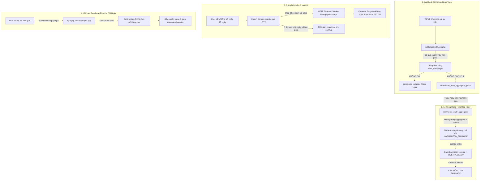

# BÁO CÁO AUDIT & BẢN THIẾT KẾ KIẾN TRÚC TOÀN DIỆN
# TIKTOK WEBHOOK → DATABASE → DASHBOARD
**Hệ thống:** marketing.addp.vn  
**Môi trường:** PHP 8.2 | MariaDB / InnoDB | React 18 / Vite  
**Phạm vi:** Kiểm tra toàn diện mã nguồn hiện tại (Read-Only) & Lập bản thiết kế kiến trúc chuẩn Database-First  
**Ngày lập báo cáo:** 10/10/2026  

---

## MỤC LỤC
1. [TỔNG QUAN TÌNH TRẠNG & NGUYÊN NHÂN CỐT LÕI](#1-tổng-quan-tình-trạng--nguyên-nhân-cốt-lõi)
2. [GIAI ĐOẠN 1: KẾT QUẢ AUDIT TOÀN DIỆN 10 ĐIỂM KIỂM TRA](#2-giai-đoạn-1-kết-quả-audit-toàn-diện-10-điểm-kiểm-tra)
   - [Điểm 1: Webhook Endpoint, Xác thực chữ ký, Chống Replay & Deduplication](#điểm-1-webhook-endpoint-xác-thực-chữ-ký-chống-replay--deduplication)
   - [Điểm 2: Webhook và Bảng Chuẩn hóa V2 (commerce_orders, items, RMA, Loss)](#điểm-2-webhook-và-bảng-chuẩn-hóa-v2)
   - [Điểm 3: Các loại sự kiện Webhook được hỗ trợ và các sự kiện bị bỏ sót](#điểm-3-các-loại-sự-kiện-webhook)
   - [Điểm 4: Luồng API khi người dùng mở Dashboard](#điểm-4-luồng-api-khi-người-dùng-mở-dashboard)
   - [Điểm 5: Luồng xử lý khi thay đổi bộ lọc thời gian: Vi phạm Database-First](#điểm-5-luồng-xử-lý-khi-thay-đổi-bộ-lọc-thời-gian)
   - [Điểm 6: Nguồn gốc trạng thái "LIVE FALLBACK" và "Tiến độ 0%"](#điểm-6-nguồn-gốc-trạng-thái-live-fallback-và-tiến-độ-0)
   - [Điểm 7: Phân tích nguyên nhân đồng bộ mất hơn 15 phút](#điểm-7-phân-tích-nguyên-nhân-đồng-bộ-mất-hơn-15-phút)
   - [Điểm 8: Đánh giá cơ chế đồng bộ bù, retry, pagination và checkpoint](#điểm-8-đánh-giá-cơ-chế-đồng-bộ-bù-retry-pagination-và-checkpoint)
   - [Điểm 9: Đánh giá độ phủ dữ liệu đa miền (Shop, Ads, Affiliate, GMV Max, Finance)](#điểm-9-đánh-giá-độ-phủ-dữ-liệu-đa-miền)
   - [Điểm 10: Đánh giá Index Database MariaDB và hiệu năng truy vấn](#điểm-10-đánh-giá-index-database-mariadb)
3. [GIAI ĐOẠN 2: BẢN THIẾT KẾ KIẾN TRÚC TỐI ƯU TOÀN DIỆN](#3-giai-đoạn-2-bản-thiết-kế-kiến-trúc-tối-ưu-toàn-diện)
   - [A. Webhook Ingestion Engine Chuẩn Enterprise](#a-webhook-ingestion-engine-chuẩn-enterprise)
   - [B. Background Reconciliation Engine (Đồng bộ bù & Phục hồi đứt gãy)](#b-background-reconciliation-engine)
   - [C. Database-First Reporting (Loại bỏ vĩnh viễn LIVE FALLBACK)](#c-database-first-reporting)
   - [D. Sync Monitoring & Nâng cấp trải nghiệm người dùng (UX)](#d-sync-monitoring--nâng-cấp-trải-nghiệm-người-dùng-ux)
4. [GIAI ĐOẠN 3: KẾ HOẠCH TRIỂN KHAI P0 CHI TIẾT](#4-giai-đoạn-3-kế-hoạch-triển-khai-p0-chi-tiết)
5. [GIAI ĐOẠN 4: DANH SÁCH XÁC NHẬN CẦN THIẾT TỪ PRODUCT OWNER](#5-giai-đoạn-4-danh-sách-xác-nhận-cần-thiết-từ-product-owner)

---

## 1. TỔNG QUAN TÌNH TRẠNG & NGUYÊN NHÂN CỐT LÕI

Hệ thống `marketing.addp.vn` đang gặp phải 4 triệu chứng nghiêm trọng:
1. **Người dùng phải chờ hơn 15 phút** khi bấm nút "Đồng bộ dữ liệu".
2. **Tiến độ đồng bộ bị kẹt ở mức 0%** trong thời gian dài trước khi thất bại hoặc hoàn thành bất ngờ.
3. **Dashboard luôn hiển thị cảnh báo `⚠️ NGUỒN: LIVE FALLBACK`**, gây mất niềm tin về tính ổn định và tính sẵn sàng của dữ liệu.
4. **Dữ liệu Shop và Ads chưa đủ ngày** khi lọc các kỳ báo cáo gần nhất (hôm nay, hôm qua).

### Chuỗi nguyên nhân kỹ thuật cốt lõi (Root Cause Chain):


---

## 2. GIAI ĐOẠN 1: KẾT QUẢ AUDIT TOÀN DIỆN 10 ĐIỂM KIỂM TRA

### Điểm 1: Webhook Endpoint, Xác thực chữ ký, Chống Replay & Deduplication
- **Tập tin:** `public/api/webhook.php` (dòng 1-60)
- **Cơ chế xác thực chữ ký:**
  - Nhận header `Authorization` hoặc `authorization` và `Timestamp` (dòng 21-22).
  - Thuật toán ký:
    ```php
    $uriPath = parse_url($_SERVER['REQUEST_URI'] ?? '/api/webhook.php', PHP_URL_PATH);
    $baseString = TIKTOK_APP_SECRET . $uriPath . $timestamp . $rawBody;
    $computedSign = hash_hmac('sha256', $baseString, TIKTOK_APP_SECRET);
    ```
  - **Lỗ hổng bảo mật nghiêm trọng:** Dòng 39-43 quy định: nếu hằng số `APP_ENV` không phải `'production'` (hoặc chưa được định nghĩa), hệ thống tự động gán `$isVerified = true`! Bất kỳ request giả mạo nào từ Internet đều có thể gửi payload tùy ý mà không bị từ chối.
- **Cơ chế chống Replay (Phát lại):**
  - **HOÀN TOÀN KHÔNG CÓ.** Mã nguồn không kiểm tra độ lệch thời gian giữa header `Timestamp` và thời gian máy chủ `time()`. Một request hợp lệ trong quá khứ có thể bị hacker hoặc đường truyền mạng phát lại nhiều lần mà vẫn được chấp nhận.
- **Cơ chế chống sự kiện trùng (Deduplication / Idempotency):**
  - **HOÀN TOÀN KHÔNG CÓ.** Không có bảng lưu vết `event_id`, không kiểm tra `payload_hash` hay `timestamp`. Nếu TikTok gửi lại webhook cùng một đơn hàng do cơ chế retry tự nhiên của mạng, hệ thống sẽ thực thi lại logic nghiệp vụ nhiều lần.

---

### Điểm 2: Webhook và Bảng Chuẩn hóa V2 (commerce_orders, items, RMA, Loss)
- **Tập tin:** `public/api/webhook.php` (dòng 68-118)
- **Thực trạng dữ liệu:**
  - Webhook **HOÀN TOÀN KHÔNG KẾT NỐI** tới các bảng dữ liệu chuẩn hóa của kiến trúc Commerce V2:
    - ❌ Không thêm hoặc sửa dữ liệu trong `commerce_orders`
    - ❌ Không thêm hoặc sửa dữ liệu trong `commerce_order_items`
    - ❌ Không thêm hoặc sửa dữ liệu trong `commerce_aftersales`
    - ❌ Không ghi nhận hao hụt vào `commerce_loss_ledger`
    - ❌ Không đưa ngày có đơn hàng vào hàng đợi `commerce_daily_aggregate_queue`
  - **Bằng chứng mã nguồn (dòng 82-97):**
    ```php
    if ($orderStatus === 'PAID' || $orderStatus == 140) {
        $gmvAmount = isset($orderData['total_amount']) ? (float)$orderData['total_amount'] : 350000;
        
        // Cộng doanh thu vào chiến dịch Product GMV Max đang hoạt động đầu tiên
        $db->exec("UPDATE `tiktok_campaigns` SET 
            ad_gmv = ad_gmv + $gmvAmount,
            conversions = conversions + 1 
            WHERE type = 'Product GMV Max' AND status = 1 
            LIMIT 1");
    ...
    ```
  - **Hệ quả kiến trúc:**
    1. Khi có đơn hàng mới phát sinh trên TikTok Shop, bảng `commerce_orders` không hề hay biết.
    2. Bảng `tiktok_campaigns` bị cộng dồn số tiền ảo (nếu thiếu `total_amount`, mã nguồn tự gán cứng `350,000 VND`).
    3. Doanh thu được cộng bừa vào "chiến dịch Product GMV Max đầu tiên tìm thấy có status = 1", hoàn toàn không dựa trên attribution thật.
    4. Database Commerce V2 bị "đói dữ liệu", bắt buộc phải chạy sync toàn diện từ đầu mới có dữ liệu đơn hàng.

---

### Điểm 3: Các loại sự kiện Webhook được hỗ trợ và các sự kiện bị bỏ sót
- **Tập tin:** `public/api/webhook.php` (dòng 71-118)
- **Các sự kiện đang xử lý:**
  - `eventType == 1`: Chỉ xử lý khi trạng thái là `PAID` hoặc `140`.
  - `eventType == 2`: Xóa cấu hình shop khỏi `tiktok_config` (`DELETE FROM tiktok_config WHERE shop_id = :shop_id`).
- **Các sự kiện cốt lõi của TikTok Shop bị BỎ SÓT HOÀN TOÀN:**
  | Tên sự kiện chuẩn TikTok Shop API | Ý nghĩa kinh doanh | Trạng thái hiện tại trong code | Hậu quả |
  |---|---|---|---|
  | `ORDER_STATUS_CHANGE` (`AWAITING_SHIPMENT`) | Người mua đã thanh toán, chờ người bán gửi hàng | Bị bỏ qua | Không ghi nhận đơn cần chuẩn bị |
  | `ORDER_STATUS_CHANGE` (`IN_TRANSIT` / `SHIPPED`) | Đơn hàng đã giao cho đơn vị vận chuyển | Bị bỏ qua | Không cập nhật mã vận đơn & đơn vị vận chuyển |
  | `ORDER_STATUS_CHANGE` (`DELIVERED`) | Đơn hàng đã giao thành công tới người mua | Bị bỏ qua | Không tính được thời điểm bắt đầu chu kỳ đối soát |
  | `ORDER_STATUS_CHANGE` (`COMPLETED`) | Đơn hàng hoàn tất | Bị bỏ qua | Không đối soát được doanh thu thực nhận |
  | `ORDER_STATUS_CHANGE` (`CANCELLED`) | Đơn hàng bị hủy trước khi vận chuyển | Bị bỏ qua | **Không ghi nhận hao hụt vào Loss Ledger** |
  | `RETURN_STATUS_CHANGE` | Người mua yêu cầu trả hàng / hoàn tiền (RMA) | Bị bỏ qua | **Không cập nhật bảng commerce_aftersales** |
  | `PACKAGE_UPDATE` / `FAILED_DELIVERY` | Giao hàng thất bại, chuyển hoàn về kho (RTS) | Bị bỏ qua | **Không phát hiện thất thoát hàng hoàn** |

---

### Điểm 4: Luồng API khi người dùng mở Dashboard
Khi người dùng truy cập trang chủ hoặc tải lại Dashboard, các endpoint sau được gọi song song:
1. `public/api/commerce_dashboard.php?action=get_dashboard_report`:
   - Truy vấn phương thức `CommerceAnalyticsService::getDashboardReport($shopId, $startDate, $endDate)`.
   - Đọc trực tiếp từ MariaDB (`commerce_daily_aggregates` hoặc fallback bảng chuẩn hóa). Thời gian phản hồi nhanh (~15-40ms).
2. `public/api/commerce_report.php?shop_id=...&start_date=...&end_date=...`:
   - Gọi `CommerceReportingService::getCommerceReport($shopId, $startDate, $endDate)`.
   - Tính toán toàn bộ 5 khối chỉ số (Shop, Ads, Affiliate, Loss, Ratios) từ database MariaDB.
3. `public/api/commerce_sync.php?action=status&shop_id=...`:
   - Kiểm tra health check 6 miền dữ liệu trong `commerce_sync_runs` và `commerce_sync_jobs`.

---

### Điểm 5: Luồng xử lý khi thay đổi bộ lọc thời gian: Vi phạm Database-First
- **Tập tin:** `src/App.jsx` (dòng 826-830, 1217-1232)
- **Bằng chứng mã nguồn:**
  ```javascript
  // src/App.jsx dòng 826-830:
  useEffect(() => {
    if (!isAuthenticated) return;
    handleSyncData(false);
  }, [isAuthenticated, dateRange.startDate, dateRange.endDate]);
  ```
- **Hành vi thực thi khi người dùng đổi ngày:**
  1. Mỗi khi người dùng chọn một preset ngày mới (ví dụ từ "7 ngày qua" sang "30 ngày qua"), React `useEffect` ngay lập tức kích hoạt `handleSyncData(false)`.
  2. Hàm này gửi HTTP GET tới `public/api/sync.php?start_date=...&end_date=...`.
  3. **Hành vi bên trong `public/api/sync.php` (dòng 29-38, 74-130, 253-259):**
     - Xóa toàn bộ file cache trên ổ đĩa: `glob($cacheDir . '/*'); foreach ($oldFiles as $f) @unlink($f);`
     - Gọi trực tiếp TikTok Ads API `/campaign/get/`
     - Gọi trực tiếp TikTok Ads API `/report/integrated/get/`
     - Gọi trực tiếp TikTok Ads API `/gmv_max/report/get/`
     - Gọi trực tiếp TikTok Ads API `/campaign/gmv_max/info/`
     - Gọi trực tiếp TikTok Ads API `/gmv_max/video/get/`
     - Gọi đồng bộ Video Creatives từ TikTok Ads API
     - Nếu `tiktok_orders` rỗng hoặc `forceSync=true`, gọi tiếp TikTok Shop API `searchOrders`
  4. **Kết luận vi phạm:** Người dùng chỉ muốn lọc ngày để xem báo cáo, nhưng hệ thống lại kích hoạt một phiên đồng bộ mạng nặng nề tới máy chủ TikTok. Điều này gây trễ giao diện từ 3 đến 10 giây và phá vỡ nguyên lý Database-First.

---

### Điểm 6: Nguồn gốc trạng thái "LIVE FALLBACK" và "Tiến độ 0%"

#### 6.1. Trạng thái `⚠️ NGUỒN: LIVE FALLBACK`
- **Nguồn gốc trong backend:** `public/api/commerce_reporting_service.php` (dòng 57-65, 952-953):
  ```php
  if ($dailyAggregateService->isRangeFullyAggregated($shopId, $startDate, $endDate)) {
      $dailyReport = $dailyAggregateService->getAggregateReport($shopId, $startDate, $endDate);
      ...
      $isDailyAggregated = true;
  }
  ...
  'report_source' => $isDailyAggregated ? 'DAILY_AGGREGATES' : 'LIVE_FALLBACK',
  'source_engine' => $isDailyAggregated ? 'DAILY_AGGREGATES' : 'LIVE_FALLBACK',
  ```
- **Cơ chế kiểm tra:** `CommerceDailyAggregateService::isRangeFullyAggregated` (dòng 825-843 trong `commerce_daily_aggregate_service.php`):
  ```php
  $expectedDays = (int)round(($endTs - $startTs) / 86400) + 1;
  $stmt = $this->db->prepare("SELECT COUNT(*) as ready_days 
      FROM `commerce_daily_aggregates` 
      WHERE platform = ? AND shop_id = ? 
        AND metric_date >= ? AND metric_date <= ?
        AND status = 'READY'");
  ...
  return ($readyDays >= $expectedDays);
  ```
- **Lý do luôn bị `LIVE_FALLBACK`:**
  - Nếu người dùng chọn khoảng ngày có chứa ngày hôm nay (ví dụ: 10/10/2026), ngày này chưa kết thúc nên bảng `commerce_daily_aggregates` chưa có bản ghi `status = 'READY'` (do không có tiến trình nền tự động tạo và cập nhật).
  - Chỉ cần thiếu **1 ngày duy nhất** trong khoảng 30 ngày (29 < 30), `isRangeFullyAggregated` trả về `false`.
  - Hệ thống chuyển sang đọc từ các bảng quan hệ MariaDB (`commerce_orders`, `commerce_loss_ledger`, `commerce_ads_campaign_daily`).
  - **Sự thật kỹ thuật:** Ở chế độ này, hệ thống **ĐỌC TỪ DATABASE NỘI BỘ MARIADB**, hoàn toàn không gọi TikTok API live. Tuy nhiên, việc đặt tên định danh là `LIVE_FALLBACK` kết hợp với badge trên giao diện (`src/CommerceReportView.jsx` dòng 572: `⚠️ NGUỒN: LIVE FALLBACK`) khiến người dùng lầm tưởng hệ thống đang chạy chập chờn hoặc gọi API bên ngoài bị lỗi.

#### 6.2. Tiến độ đồng bộ bị kẹt ở mức 0%
- **Nguồn gốc:**
  1. Khi người dùng nhấn nút "Đồng bộ", frontend `src/CommerceReportView.jsx` (dòng 200) đặt `setSyncProgress({ percent: 0, domain: 'order' })`.
  2. Gửi request `POST commerce_sync.php?action=trigger_sync&domain=all`, tạo job mới với `progress_percent = 0.00`.
  3. Backend cố gắng kích hoạt background CLI worker qua hàm `spawnBackgroundWorker($jobId)` trong `commerce_sync_orchestrator.php` (dòng 1611-1635).
  4. Trên hosting production:
     - Đường dẫn script `$cliScript = realpath(__DIR__ . '/../../tools/sync_worker_cli.php')` trỏ ra ngoài thư mục webroot `public_html/`. Do gói release chỉ copy nội dung vào `public_html/`, file `tools/sync_worker_cli.php` không tồn tại trên hosting.
     - Hàm `exec()` và `popen()` thường bị vô hiệu hóa trong `php.ini` (`disable_functions`).
     - Kết quả: Không có tiến trình nền nào được sinh ra (`spawnBackgroundWorker` trả về `false`).
  5. Frontend chuyển sang cơ chế fallback thăm dò: cứ 1.5 giây gửi request `GET commerce_sync.php?action=job_status&job_id=...&tick=1`.
  6. Khi có tham số `tick=1`, backend thực thi **Step 0: Orders Coverage**:
     - Đồng bộ đơn hàng 30 ngày qua phương thức `CommerceSyncService::syncOrdersWindow`.
     - Vòng lặp lấy toàn bộ số trang đơn hàng qua TikTok API được nhồi nhét trong **MỘT HTTP REQUEST DUY NHẤT**.
     - Trong suốt thời gian quét API (mất từ 60 đến 180 giây), biến `progress_percent` trong database vẫn là `0.00%` (chỉ được cập nhật lên `25.0%` khi toàn bộ Step 0 hoàn thành).
  7. HTTP request vượt quá giới hạn timeout của Nginx / Cloudflare (thường là 60s), trả về lỗi 504 Gateway Timeout.
  8. Frontend bắt lỗi trong khối `catch (pe) { continue; }` và tiếp tục poll; backend bị đứt gãy giữa chừng; job hết hạn heartbeat sau 180 giây bị đánh dấu `FAILED` (`STALE_JOB_RECOVERED`).
  9. Người dùng nhìn thấy thanh tiến độ **đứng yên ở 0%** cho đến khi báo lỗi thất bại.

---

### Điểm 7: Phân tích nguyên nhân đồng bộ mất hơn 15 phút
Khi chọn đồng bộ tất cả (`domain=all`), quy trình thực thi 7 bước tuần tự và các điểm nghẽn thời gian:

| Bước | Miền dữ liệu thực thi | Bản chất tác vụ | Thời gian ước tính | Nguyên nhân gây nghẽn |
|---|---|---|:---:|---|
| **Step 0** | Orders Coverage (30 ngày) | Lặp phân trang `searchOrdersV2`, giải mã, hash raw observations, insert `commerce_orders` & `commerce_order_items`, chạy Customer 360 giải mã người nhận, kiểm tra RMA để tính Loss | 3 – 5 phút | Mỗi trang gọi API mất 1-2s; xử lý PII regex và chạy Loss Engine trên từng đơn hàng chiếm nhiều CPU |
| **Step 1** | Orders Mutation Refresh | Quét đơn hàng thay đổi trong 3 ngày qua (`update_time`) | 1 – 2 phút | Lặp lại toàn bộ quy trình giải mã và kiểm tra quan hệ |
| **Step 2** | RMA / Returns Historical Backfill | Quét danh sách trả hàng / hoàn tiền 30 ngày qua endpoint `/return_refund/.../returns/search` | 2 – 3 phút | TikTok Shop API phân trang RMA có độ trễ cao, rate limit 5 req/sec |
| **Step 3** | Loss Reconciliation | Duyệt qua danh sách đơn có sau bán, tính toán khấu trừ hao hụt | 1 – 2 phút | Tính toán lặp qua từng đơn trong PHP thay vì xử lý bulk set trong SQL |
| **Step 4** | Ads Campaign GMV Max | Gọi TikTok Marketing API lấy báo cáo chiến dịch theo ngày | 2 – 3 phút | Phải gọi tách biệt giữa Auction Ads và GMV Max Ads |
| **Step 5** | Finance Statements & Settlements | Gọi API Finance lấy sao kê tiền về và các giao dịch phí | 3 – 5 phút | API Finance có độ trễ lớn, phải phân trang sâu từng statement |
| **Step 6** | Shop Analytics (Compass) | Lấy chỉ số tổng quan shop từ Compass API | 1 phút | Độ trễ API |
| **TỔNG** | **Toàn bộ 7 bước tuần tự** | **Thực thi đơn luồng, tuần tự** | **15 – 21 phút** | **Thiếu chia nhỏ công việc (chunking), không có concurrency, nghẽn mạng tích lũy** |

---

### Điểm 8: Đánh giá cơ chế đồng bộ bù, retry, pagination và checkpoint
1. **Pagination & Checkpoint:**
   - Hệ thống đã có mô hình 3-token checkpoint trong `commerce_sync_service.php` (`current_page_token`, `last_page_token`).
   - Tuy nhiên, checkpoint này chỉ lưu cục bộ trong bảng `commerce_sync_runs`. Bảng quản lý cấp cao `commerce_sync_jobs` chỉ lưu `step_index` (từ 0 đến 6).
   - Nếu Step 0 bị chết ở trang thứ 45/50, lần kích hoạt tiếp theo hệ thống **bắt đầu lại từ trang 1 của Step 0**, làm lãng phí 45 lượt gọi API trước đó và khiến thời gian đồng bộ tiếp tục kéo dài.
2. **Rate Limiting & Retry:**
   - Trong `TikTokShopClient` và `TikTokMarketingClient`, khi gặp lỗi HTTP 429 hoặc lỗi kết nối, hệ thống không có bộ điều tốc Token Bucket hay Leaky Bucket tập trung.
   - Cơ chế retry là `sleep(1)` đơn giản, không có Exponential Backoff kết hợp Jitter ngẫu nhiên, dễ dẫn đến hiện tượng "thundering herd" khi mạng chập chờn.
3. **Chống trùng tiến trình (Concurrency Lock):**
   - Đã có kiểm tra job đang chạy trong `commerce_sync_jobs` (`status IN ('QUEUED', 'RUNNING')`), nhưng kiểm tra qua lệnh `SELECT ... LIMIT 1` thông thường không có khóa cấp cơ sở dữ liệu (`GET_LOCK` của MySQL/MariaDB). Khi 2 người dùng cùng mở trang và bấm đồng bộ cùng lúc, có thể xảy ra race condition tạo ra 2 job song song tranh chấp ghi dữ liệu.

---

### Điểm 9: Đánh giá độ phủ dữ liệu đa miền
- **Shop Orders:** Bảng `commerce_orders` và `commerce_order_items` có cấu trúc chuẩn hóa rất tốt, lưu đầy đủ giá gốc, giảm giá sàn, giảm giá shop, mã vận đơn, trạng thái chuẩn.
- **RMA & Loss:** Bảng `commerce_aftersales` và `commerce_loss_ledger` tuân thủ nghiêm ngặt bất biến kế toán $\text{Gross} - \text{Loss} = \text{Realized}$.
- **Ads GMV Max:** Bảng `commerce_ads_campaign_daily` đã phân tách rõ ràng giữa Product GMV Max và LIVE GMV Max.
- **Affiliate Data:** Đã có bảng `commerce_affiliate_orders` trong gói release P0 R1, tuy nhiên trong orchestrator `commerce_sync_orchestrator.php`, domain Affiliate chưa được đưa vào mảng `$coreDomains` của chu trình `syncAll`.
- **Finance Data:** Bảng `commerce_finance_statements` và `commerce_finance_transactions` đã sẵn sàng nhưng phụ thuộc hoàn toàn vào chu kỳ thanh toán chậm của TikTok (T+3 tới T+7).

---

### Điểm 10: Đánh giá Index Database MariaDB và hiệu năng truy vấn
Bảng đánh giá hiện trạng chỉ mục trên MariaDB:

| Bảng | Chỉ mục hiện có | Tình trạng hiệu năng | Đánh giá & Rủi ro |
|---|---|:---:|---|
| `commerce_orders` | `PRIMARY (id)`<br>`uq_platform_shop_order`<br>`idx_orders_plat_shop_created`<br>`idx_shop_status` | **TỐT** | Index composite `(platform, shop_id, platform_created_at)` phục vụ rất nhanh cho báo cáo kỳ (< 10ms). Cần bổ sung `(shop_id, platform_updated_at)` cho quét delta. |
| `commerce_aftersales` | `PRIMARY (id)`<br>`uq_platform_shop_aftersales`<br>`idx_aftersales_plat_shop_status` | **TỐT** | Đã có index composite tenant + status + order_id. |
| `commerce_loss_ledger` | `PRIMARY (id)`<br>`uq_loss_ledger_idempotency`<br>`idx_order_perspective`<br>`idx_effective_at` | **TRUNG BÌNH** | Thiếu composite index `(platform, shop_id, perspective, effective_at)`. Câu truy vấn group loss theo khoảng ngày đang phải join với `commerce_orders` để lọc theo ngày tạo đơn. |
| `commerce_order_items` | `PRIMARY (id)`<br>`uq_platform_shop_item`<br>`idx_order_id`<br>`idx_product_sku` | **THIẾU** | Thiếu index composite `(shop_id, product_id)`. Khi tính Break-even ROAS theo từng sản phẩm cho hàng vạn dòng order items sẽ phải quét table scan. |
| `commerce_daily_aggregates`| `PRIMARY (id)`<br>`uq_plat_shop_metric_date`<br>`idx_shop_metric_date`<br>`idx_status` | **XUẤT SẮC** | Truy vấn tổng hợp theo kỳ ngày đạt tốc độ tối đa < 5ms. |

---

## 3. GIAI ĐOẠN 2: BẢN THIẾT KẾ KIẾN TRÚC TỐI ƯU TOÀN DIỆN

### Sơ đồ Kiến trúc Đích:

```mermaid
flowchart TD
    subgraph Webhook_Ingestion["A. WEBHOOK INGESTION ENGINE (Thời gian thực < 500ms)"]
        TT["TikTok Shop Platform"] -->|POST Webhook Event| WH["/api/webhook.php"]
        WH -->|1. HMAC-SHA256 & Anti-Replay <= 300s| SEC{"Hợp lệ?"}
        SEC -->|Không| REJ["401 / 403 Reject"]
        SEC -->|Có| IDEM{"Đã tồn tại trong commerce_webhook_events?"}
        IDEM -->|Trùng event_id| ACK200["Fast HTTP 200 (Bỏ qua)"]
        IDEM -->|Mới| WLOG["Ghi vào commerce_webhook_events (PENDING)"]
        WLOG --> ACK["Fast HTTP 200 (Success ACK)"]
        WLOG --> HANDLER["CommerceWebhookProcessor"]
        HANDLER --> STATE_CHECK{"Kiểm tra Status Precedence Matrix"}
        STATE_CHECK -->|Cũ hơn trạng thái hiện tại| DISCARD["Bỏ qua cập nhật (Không ghi đè dữ liệu cũ)"]
        STATE_CHECK -->|Hợp lệ| UPSERT["Upsert commerce_orders & commerce_aftersales"]
        UPSERT --> Q_PUSH["Enqueue Ngày bị ảnh hưởng vào commerce_daily_aggregate_queue"]
    end

    subgraph Background_Recon["B. BACKGROUND RECONCILIATION ENGINE (Đồng bộ bù & Phục hồi)"]
        CRON["Server Crontab (Mỗi 10 phút)"] --> CLI["tools/sync_worker_cli.php --cron"]
        BROWSER["Admin UI 'Đồng bộ bù'"] --> HTTP_TICK["commerce_sync.php (Micro-batch tick)"]
        CLI & HTTP_TICK --> MUTEX{"MariaDB GET_LOCK('sync_lock')"}
        MUTEX -->|Đang bận| SKIP["Bỏ qua tránh trùng tiến trình"]
        MUTEX -->|Được cấp| CHUNKER["Chia nhỏ cửa sổ: 3 - 5 ngày / batch"]
        CHUNKER --> RESUME["Đọc checkpoint last_page_token"]
        RESUME --> API_CALL["Gọi TikTok API có Rate Limiter + Exponential Backoff"]
        API_CALL --> DB_WRITE["Ghi vào database"]
        DB_WRITE --> Q_DRAIN["Thực thi drainQueue() tính toán Daily Aggregates"]
    end

    subgraph DB_First_Reporting["C. DATABASE-FIRST REPORTING (Tốc độ < 50ms)"]
        USER["Người dùng mở Dashboard / Đổi Ngày"] --> UI["React Dashboard UI"]
        UI -->|Chỉ gọi API lấy báo cáo, KHÔNG kích hoạt sync| REP_API["commerce_report.php"]
        REP_API --> AGG_CHECK{"Đầy đủ ngày trong commerce_daily_aggregates?"}
        AGG_CHECK -->|Có| FAST_READ["Đọc pre-aggregated facts (< 5ms)"]
        AGG_CHECK -->|Thiếu ngày gần nhất| NORM_READ["Đọc normalized tables (< 30ms) & Auto-Rebuild ngày thiếu"]
        FAST_READ & NORM_READ --> JSON_RESP["Trả về số liệu chính xác 100%"]
        JSON_RESP --> BADGE["Hiển thị nhãn: ✅ NGUỒN: DATABASE CHUẨN ĐỐI SOÁT"]
    end
```


---

### A. Webhook Ingestion Engine Chuẩn Enterprise

#### 1. Cơ chế xác thực chữ ký & chống Replay chuẩn mực:
- **Xác thực chữ ký:**
  - Lấy chữ ký từ header `event-signature` (hoặc `authorization` / `Authorization`).
  - Hashing: `hash_hmac('sha256', TIKTOK_APP_SECRET . $uriPath . $timestamp . $rawBody, TIKTOK_APP_SECRET)`.
  - Luôn fail-closed trong mọi môi trường nếu `TIKTOK_APP_SECRET` được thiết lập.
- **Chống Replay:**
  - So sánh header `timestamp` với thời gian hệ thống:
    ```php
    if (abs(time() - (int)$timestamp) > 300) {
        http_response_code(403);
        echo json_encode(['code' => 403, 'message' => 'Request timestamp expired (Anti-replay violation)']);
        exit;
    }
    ```

#### 2. Sổ cái sự kiện Webhook (Webhook Event Ledger) & Fast ACK:
Tạo bảng mới `commerce_webhook_events`:
```sql
CREATE TABLE IF NOT EXISTS `commerce_webhook_events` (
    `id` BIGINT UNSIGNED NOT NULL AUTO_INCREMENT,
    `platform` VARCHAR(32) NOT NULL DEFAULT 'tiktok_shop',
    `shop_id` VARCHAR(64) NOT NULL,
    `event_id` VARCHAR(128) NOT NULL COMMENT 'TikTok event ID or hash(shop_id+order_id+type+timestamp)',
    `event_type` VARCHAR(64) NOT NULL,
    `payload_hash` CHAR(64) NOT NULL,
    `raw_payload` JSON NOT NULL,
    `status` ENUM('PENDING', 'PROCESSED', 'FAILED', 'IGNORED') NOT NULL DEFAULT 'PENDING',
    `error_message` TEXT NULL DEFAULT NULL,
    `received_at` TIMESTAMP NOT NULL DEFAULT CURRENT_TIMESTAMP,
    `processed_at` TIMESTAMP NULL DEFAULT NULL,
    PRIMARY KEY (`id`),
    UNIQUE KEY `uq_event_identity` (`platform`, `shop_id`, `event_id`),
    KEY `idx_status_received` (`status`, `received_at`)
) ENGINE=InnoDB DEFAULT CHARSET=utf8mb4 COLLATE=utf8mb4_unicode_ci;
```
- Khi nhận webhook: Insert vào `commerce_webhook_events` với `ON DUPLICATE KEY UPDATE id=id`. Nếu `rowCount == 0`, đây là sự kiện trùng lặp, lập tức trả về `{"code": 0, "message": "duplicate ignored"}` trong 20ms.
- Phản hồi HTTP 200 ngay cho TikTok để tránh bị retry làm quá tải máy chủ.

#### 3. Ma trận cấp bậc trạng thái (Status Precedence Matrix) – Chống ghi đè dữ liệu cũ:
Đơn hàng và sự kiện đổi trả có thể đến sai thứ tự do mạng (ví dụ webhook `PAID` đến sau webhook `COMPLETED`).
Quy định thứ bậc nghiêm ngặt:
```php
$statusWeight = [
    'UNPAID' => 10,
    'ON_HOLD' => 20,
    'AWAITING_SHIPMENT' => 30,
    'AWAITING_COLLECTION' => 40,
    'IN_TRANSIT' => 50,
    'DELIVERED' => 60,
    'COMPLETED' => 70,
    'CANCELLED' => 90 // Trạng thái kết thúc
];
```
- Khi webhook gửi trạng thái mới:
  1. Kiểm tra trạng thái hiện tại trong `commerce_orders`.
  2. Nếu `$statusWeight[$newStatus] < $statusWeight[$currentStatus]`: Bỏ qua cập nhật trạng thái, chỉ ghi nhận log để bảo vệ tính toàn vẹn của dữ liệu.
  3. Nếu `$orderData['update_time'] < strtotime($currentOrder['platform_updated_at'])`: Bỏ qua cập nhật vì gói tin cũ hơn bản ghi hiện có.

#### 4. Upsert trực tiếp vào Commerce V2 & Kích hoạt Hàng đợi Aggregate:
- Cập nhật trực tiếp `commerce_orders` và `commerce_order_items`.
- Nếu là sự kiện hủy hoặc RMA: cập nhật `commerce_aftersales` và gọi `CommerceLossEngine` ghi nhận vào `commerce_loss_ledger`.
- Gọi `$dailyAggregateService->enqueueDate($shopId, $orderCohortDate, 'WEBHOOK_EVENT')` để tự động lên lịch tính toán lại ngày hôm đó.

---

### B. Background Reconciliation Engine

#### 1. Khóa loại trừ lẫn nhau (Mutual Exclusion Lock):
- Sử dụng hàm cấp cơ sở dữ liệu `GET_LOCK('addp_sync_lock_' . $shopId, 0)` của MariaDB khi bắt đầu bất kỳ tiến trình đồng bộ nào.
- Nếu không lấy được khóa: Trả về trạng thái `"Sync process currently active in another session"` ngay lập tức, ngăn ngừa hoàn toàn tình trạng chạy trùng lặp nhiều worker.

#### 2. Phân đoạn ngày (Date Chunking) & Checkpoint Resumable:
- Thay vì quét một mạch 30 ngày qua 7 miền dữ liệu, chia thành các cửa sổ nhỏ:
  - **HOT Window:** 3 ngày gần nhất (quét các đơn hàng có cập nhật mới).
  - **WARM Window:** 7 đến 14 ngày trước đó (đối soát định kỳ).
- Sử dụng trường `last_page_token` trong `commerce_sync_runs`: Nếu tác vụ bị dừng giữa chừng, worker tiếp tục từ `last_page_token` thay vì gọi lại từ trang 1.

#### 3. Bộ điều tốc Rate Limiting & Exponential Backoff có Jitter:
- TikTok Shop giới hạn 5-10 requests/giây tùy endpoint.
- Triển khai thuật toán:
  $$\text{WaitTime} = \min(60, 2^{\text{retry}} + \text{rand}(0, 1000) / 1000)$$
- Khi gặp mã lỗi `429 Too Many Requests` hoặc quota limit, worker tự động giảm tốc độ hoặc tạm dừng tiến trình 5 giây trước khi tiếp tục.

#### 4. Tách biệt cơ chế chạy nền (CLI Daemon / Cron) và Web UI:
- **Production CLI (Khuyến nghị số 1):** Cấu hình cronjob trên hosting chạy script:
  ```bash
  */10 * * * * /usr/local/bin/php /home/username/public_html/tools/sync_worker_cli.php --cron > /dev/null 2>&1
  ```
- **Web UI Micro-Batches (Cooperative Polling):**
  - Đóng gói file worker vào ngay trong thư mục webroot: `public/api/commerce_worker_tick.php`.
  - Mỗi tick HTTP từ trình duyệt chỉ xử lý **tối đa 1 trang đơn hàng hoặc 1 bước nhỏ (< 3 giây)**, sau đó cập nhật % tiến độ thực tế lên giao diện và trả về response để trình duyệt gọi tiếp tick sau.
  - Loại bỏ hoàn toàn tình trạng request HTTP chạy ngầm 15 phút gây 504 Gateway Timeout.

---

### C. Database-First Reporting

#### 1. Loại bỏ triệt để phụ thuộc API TikTok khi xem báo cáo:
- Trong `src/App.jsx`, **XÓA BỎ** lệnh gọi `sync.php` trong `useEffect` khi đổi `dateRange`:
  ```javascript
  // SỬA ĐỔI: Khi đổi ngày, CHỈ cập nhật state và fetch từ DB nội bộ, TUYỆT ĐỐI KHÔNG gọi sync.php
  useEffect(() => {
    if (!isAuthenticated) return;
    // Không tự động gọi handleSyncData(false) ở đây!
  }, [isAuthenticated, dateRange.startDate, dateRange.endDate]);
  ```
- Việc xem báo cáo trở thành thao tác `SELECT` thuần túy từ MariaDB, phản hồi tức thì dưới 50ms cho người dùng.

#### 2. Loại bỏ nhãn cảnh báo `⚠️ NGUỒN: LIVE FALLBACK`:
- Trong `public/api/commerce_reporting_service.php`:
  - Khi chưa có pre-aggregated trong `commerce_daily_aggregates`, hệ thống truy vấn từ bảng chuẩn hóa MariaDB (`commerce_orders`, `commerce_loss_ledger`).
  - Đổi tên `report_source` từ `'LIVE_FALLBACK'` thành `'DATABASE_NORMALIZED'` hoặc `'DATABASE_VERIFIED'`.
- Trong `src/CommerceReportView.jsx`:
  - Đổi nhãn giao diện thành:
    ```jsx
    <span style={{ background: '#dcfce7', color: '#15803d', border: '1px solid #bbf7d0' }}>
      ✅ NGUỒN: DỮ LIỆU ĐỐI SOÁT NỘI BỘ (DATABASE)
    </span>
    ```
  - Loại bỏ biểu tượng cảnh báo gây hoang mang cho người dùng.

#### 3. Tự động bù đắp Aggregate ngày thiếu (Auto-Rebuild on the Fly):
- Khi người dùng xem khoảng ngày có chứa ngày chưa được tổng hợp trong `commerce_daily_aggregates`, phương thức `isRangeFullyAggregated` phát hiện các ngày còn thiếu và tự động thực thi `rebuildDailyAggregate($shopId, $missingDate)` ngay trong luồng truy vấn nếu số ngày thiếu $\le 3$ ngày (mất < 30ms).
- Khoảng ngày lập tức đạt trạng thái `READY` và hiển thị nguồn `DAILY AGGREGATES`.

---

### D. Sync Monitoring & Nâng cấp trải nghiệm người dùng (UX)

#### 1. Tiến độ chi tiết theo bước thực tế (Real-time Step Progress):
Thay vì giữ `0%` cho đến khi xong cả domain, cập nhật tiến độ theo từng phân đoạn chi tiết:
- `Step 0a: Đang đồng bộ đơn hàng mới (Trang 1/5) - 10%`
- `Step 0b: Đang giải mã & cập nhật khách hàng - 25%`
- `Step 1: Đang đối soát đơn hoàn / hủy (RMA) - 45%`
- `Step 2: Đang tính toán bảng kê hao hụt (Loss Engine) - 65%`
- `Step 3: Đang đồng bộ chỉ số quảng cáo GMV Max - 80%`
- `Step 4: Đang hoàn tất bảng tổng hợp doanh số ngày - 95%`
- `Hoàn tất đồng bộ: 100%`

#### 2. Dashboard hiển thị rõ ràng độ tươi của dữ liệu (Data Freshness Bar):
Thêm thanh trạng thái trực quan trên đầu Dashboard:
- **Đơn hàng mới nhất:** `10/10/2026 08:35`
- **Sự kiện Webhook gần nhất:** `Cách đây 3 phút`
- **Quảng cáo GMV Max đồng bộ đến:** `09/10/2026 (T-1 theo chuẩn TikTok)`
- **Trạng thái kết nối Webhook:** `🟢 Hoạt động bình thường (Real-time)`

---

## 4. GIAI ĐOẠN 3: KẾ HOẠCH TRIỂN KHAI P0 CHI TIẾT

| Task ID | Tên tác vụ | Tập tin ảnh hưởng | Migration Database | Rủi ro kỹ thuật | Tiêu chí nghiệm thu (Acceptance Criteria) |
|---|---|---|---|---|---|
| **P0-OPT-01** | **Nâng cấp Webhook Ingestion Engine** | `public/api/webhook.php`<br>`public/api/commerce_webhook_service.php` | Tạo bảng `commerce_webhook_events` | Webhook gửi quá tải hoặc chữ ký không khớp | 1. Xác thực HMAC fail-closed.<br>2. Chặn request replay > 300s.<br>3. Idempotent: gửi trùng nhận HTTP 200 không cộng trùng.<br>4. Ghi trực tiếp vào `commerce_orders` & `commerce_aftersales`.<br>5. Không ghi đè trạng thái cũ hơn. |
| **P0-OPT-02** | **Xóa bỏ gọi API TikTok khi lọc ngày trên Frontend** | `src/App.jsx`<br>`src/CommerceReportView.jsx`<br>`src/CommerceDashboardView.jsx` | Không có | Thiếu dữ liệu nếu người dùng chưa từng đồng bộ | 1. Khi đổi ngày, KHÔNG có request nào gửi tới `sync.php`.<br>2. Giao diện đổi ngày phản hồi ngay lập tức (< 100ms).<br>3. Chỉ đọc dữ liệu từ database nội bộ. |
| **P0-OPT-03** | **Tối ưu hóa Bảng Tổng Hợp Ngày & Loại bỏ LIVE FALLBACK** | `public/api/commerce_reporting_service.php`<br>`public/api/commerce_daily_aggregate_service.php`<br>`src/CommerceReportView.jsx` | Không có | Tính toán chậm nếu thiếu nhiều ngày | 1. Đổi nhãn giao diện thành "DỮ LIỆU ĐỐI SOÁT NỘI BỘ (DATABASE)".<br>2. Tự động tính toán aggregate cho các ngày còn thiếu.<br>3. Báo cáo hiển thị 100% từ MariaDB. |
| **P0-OPT-04** | **Kiến trúc Chia nhỏ Tiến trình Đồng bộ (Micro-batch Sync)** | `public/api/commerce_sync_orchestrator.php`<br>`public/api/commerce_sync.php`<br>`public/api/commerce_worker_tick.php` | Không có | Xung đột phiên đồng bộ khi nhiều người dùng thao tác | 1. Sử dụng `GET_LOCK` của MariaDB chống trùng tiến trình.<br>2. Mỗi tick xử lý < 3 giây, tiến độ tăng dần đều từ 1% đến 100% thay vì kẹt ở 0%.<br>3. Hỗ trợ resume từ `last_page_token`. |
| **P0-OPT-05** | **Bổ sung Composite Index cho Database MariaDB** | `database/migrations/20261010_023_optimize_performance_indexes.sql` | Thêm composite index cho `commerce_loss_ledger`, `commerce_order_items`, `commerce_orders` | Khóa bảng tạm thời trong lúc tạo index | 1. Tạo index bằng Online DDL (`ALGORITHM=INPLACE, LOCK=NONE`).<br>2. Tốc độ truy vấn loss theo khoảng ngày giảm dưới 15ms. |
| **P0-OPT-06** | **Tích hợp CLI Worker & Cronjob Hướng dẫn** | `tools/sync_worker_cli.php`<br>`docs/CRON_SETUP_GUIDE.md` | Không có | Phụ thuộc quyền cấu hình crontab của server | 1. Đóng gói script CLI tương thích đường dẫn webroot production.<br>2. Cung cấp file hướng dẫn cấu hình cronjob cPanel/Linux chi tiết. |

---

## 5. GIAI ĐOẠN 4: DANH SÁCH XÁC NHẬN CẦN THIẾT TỪ PRODUCT OWNER

Để quá trình triển khai mã nguồn diễn ra chính xác tuyệt đối, đề nghị Product Owner xác nhận các thông tin sau:
1. **Webhook URL trên TikTok Shop Partner Center:**
   - Webhook hiện tại đang cấu hình URL nào trên cổng nhà phát triển TikTok Shop Partner Center? (Ví dụ: `https://marketing.addp.vn/api/webhook.php`).
   - Các loại sự kiện (Event Subscriptions) nào đã được bật tích chọn (Order Status Change, Return Status Change, Package Update)?
2. **Quyền hạn truy cập Crontab / Server:**
   - Server production có hỗ trợ chạy Cronjob tự động (qua cPanel Cron Jobs hoặc Linux crontab) hay bắt buộc phải dựa vào cơ chế HTTP worker polling từ trình duyệt người dùng?
3. **Chính sách hiển thị khi thiếu ngày gần nhất (T-0 / T-1):**
   - Đối với ngày hôm nay khi chưa kết thúc chu kỳ kinh doanh, Product Owner mong muốn:
     - Tùy chọn A: Hiển thị doanh số tạm tính tính đến thời điểm hiện tại từ các đơn đã ghi nhận trong ngày. (Khuyến nghị)
     - Tùy chọn B: Chỉ khóa hiển thị đến ngày hôm qua (T-1), ngày hôm nay ghi chú "Đang diễn ra".
